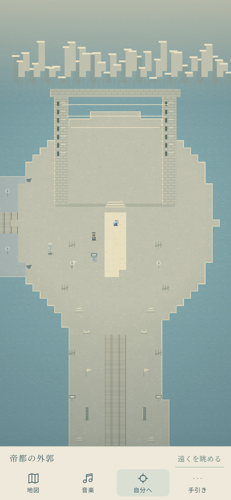

# カメラ・選曲・建築タップの改善

2026-10-29の依頼を採用根拠とする。通常タップでは主人公へ毎回構図を戻さず、画面内を歩かせる。地図の長距離移動は進行方向の構図を保つ。通常屋外0.8を維持し、巡礼の雲上だけ0.46、帝都の外郭と最後の器で0.38へ引く。作者指定の展望だけを対象とし、空間的ヒステリシス・滞在待ち・退出保持を使う。Reduced Motionでは従来の0.6までに抑える。手動ズームは追加しない。

音楽は既存90曲の音源と設定を維持する。草原は前進感、峡谷は切なく勇ましい速度のある曲、乾いた庭は受水庭と同旋律、宿道は帰路の余情、帝都は荘厳な曲へ。曲数増加より選曲の順路上の対比を重視する。閉殿の静けさは維持する。

描画と衝突を同じ建築の柱・壁に合わせ、背の高い部分の現地タップは調査へつなぐ。空いた門中央を見えない壁として扱わない。物理地形と経路探索は変更しない。変更範囲は中リスクのカメラ・選曲・視覚的ヒット検査。既存回帰に加え、短距離反復タップ、巨大遠景の出入り、描画高所のタップと通路を検査する。

PR #79と#81は最新mainへ統合済み。本変更はmain c3da706を基準とする。GitHub APIは現環境で403拒否されるため、Issue/PRのAPI作成とマージが現時点でブロックされている。依頼と受入範囲を本書へ残し、通信が利用可能なら正規PRを作成・検証・マージする。main直接pushは行わない。

## 確認した操作

- Node検査158件成功。旧地形・全域接続・全地点往復・柱と床・前景透過・音楽ライブラリの既存検査を保持。
- Chromiumで現在の巡礼43区間・13地域を、通常の地図/キー/現地タップで検査（ブラウザ時計を進めるため人間の実時間試遊ではない）。強い引きの倍率と各描画フレームの変化量を確認。初回で検出した速すぎる倍率変化を修正し、再走で成功。
- 時計を進めない別のブラウザ操作で、通常の地面タップを4回往復。カメラ中心は前後とも (944,3376) のままで、主人公だけが移動することを確認。
- 建築高所タップが調査へつながり、開いた床は歩け、柱は実際に移動キーを止める。物理的な高所の空中衝突は追加しない。

試遊：船着場で近い地面を何度か往復タップ→草原→峡谷（速度のある選曲）→雲上（水尺で少し待つ）→水庭/乾いた庭→宿道→閉殿→帝都門→最後の器。見せ場では数秒立ち止まり、門全体と周囲の道が現れるまで見比べる。BGMは既定OFFのため必要に応じてONにする。

iPhone/Safari実機、実耳、低性能端末の電池/発熱、独立監査は未確認。画角の好みと音楽の感情は、人間の試遊で判断する。最新版のPR/CIと公開の状態は作業報告を参照。

最終検証：`npm run check` 158件成功、失敗0。`CHROMIUM_EXECUTABLE=/usr/bin/chromium npm run test:browser` は全体を一括実行して終了コード0。巡礼43区間、従来旅・旧2世界・ミニ、迷路A/Bの全6条件、Reduced Motion、3画面サイズの44px操作領域、音声PCM・停止/復帰・4.2秒負荷の録音・スマホ/タブレット/デスクトップのレイアウトを含む。Chromiumは環境の既存版でありSafari実機ではない。検証後は文書とスクリーンショットのみを追記した。
