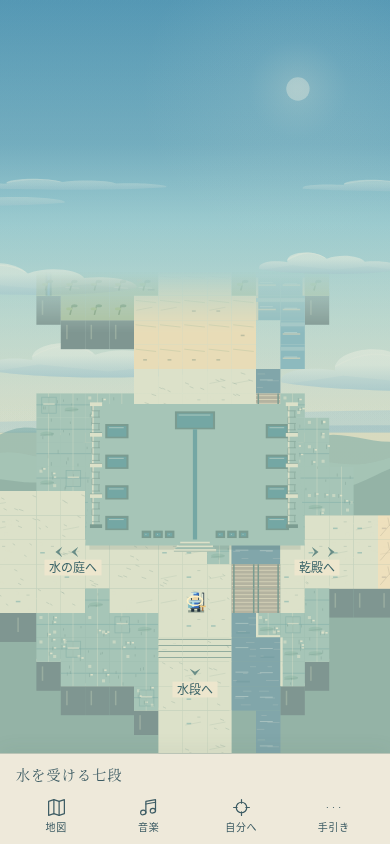
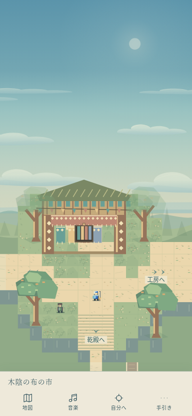
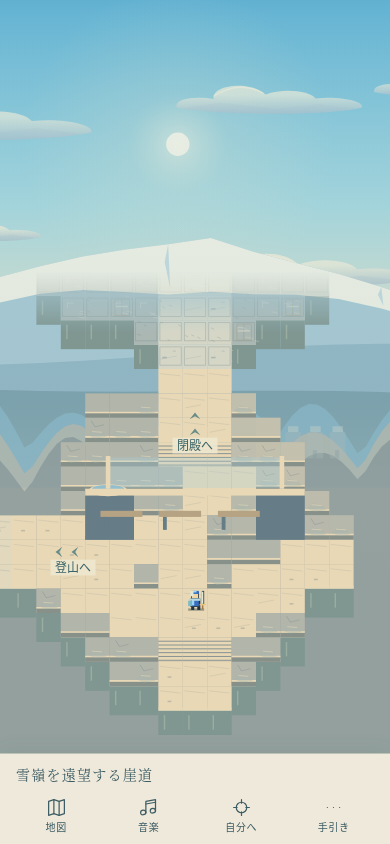
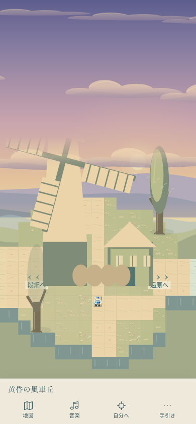
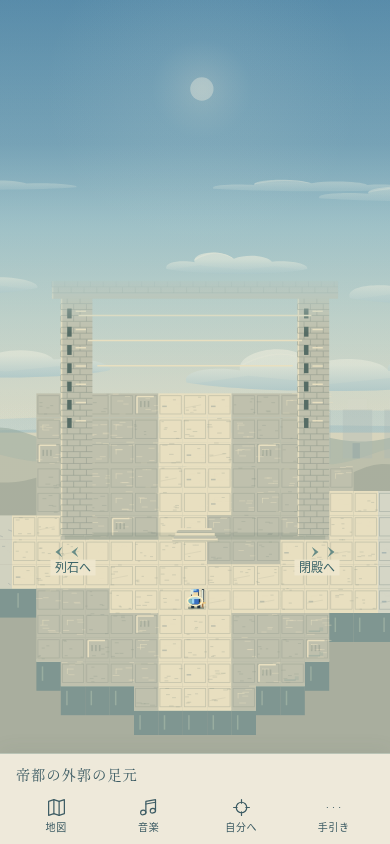
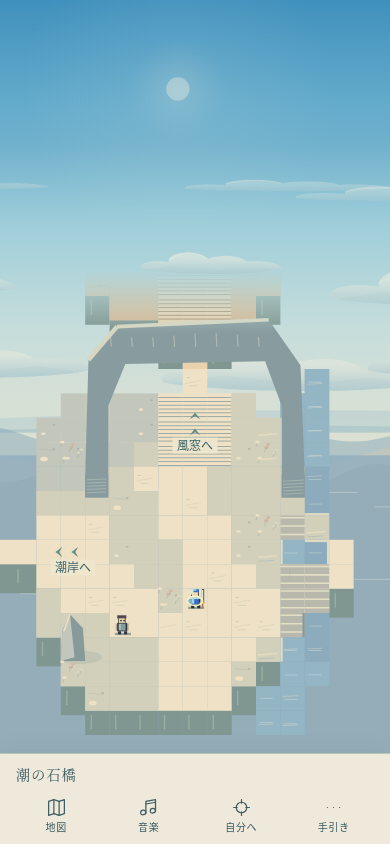

# 空の枝道 — 景観を歩き比べる33画面（Issue #120）

現行#122は10×10＝100枚へ拡張。各15×15と既存の周回を残し、最新の空/曲/設備/QAは[100枚の台帳](FIXED-HUNDRED-ATLAS.md)。以下の8/33枚の数値は当時の記録。

固定画面方式を比較するための独立した実験エリアであり、全体への採用は未決定。既存の8画面を残し、その帰り並木の東から25画面を追加した。既存メイン480×832、33地域・87施設・32NPC・全110曲、旧モードは変更しない。

## 入り方と試遊ルート

通常の試遊道標、ランダム試遊の案内、または手引きから「空の枝道へ（画面切替）」。**集落→東の帰り並木→東の水路を渡る庭→東の受水殿**から長い旅へ入る。出口の地名・矢印か、地図の隣接地名を選んで実際に歩く。

- 水と海の周回：受水殿→東の乾殿→舟原→宿→草原→風窓→南の海門→西の潮岸→河港→葦原→乾段→水段→北の受水殿。水と乾いた設備は対応する形だが、同じ場所の過去未来とは確定しない。
- 北の周回：受水殿→北の温室→北の段畑→東の風車→遠原→列石→帝門→閉殿→南の雪嶺→西の登山→霧森→工房→森市→温室→南の受水殿。
- 短絡：乾殿↔森市、草原↔登山、河港↔宿、列石↔霧森。往路と復路で異なる順に曲と建築を比べられる。以前の高庭の一周と短い周回も残る。

全画面の歩行中・遷移中から、手引きの「元の場所へ戻る」で帰還できる。入口まで歩いて戻る場合は集落の帰りの道標を使う。元世界の安全な確定床・保持カメラ・選曲・静けさへ戻し、古い経路と入力は復元しない。入場中に変えた音量とON/OFFは維持する。

## 技術計画・照合

既存の固定カメラ、画面内A*、歩行途中の再経路、15×15・32px/タイル、共通等方倍率、560ms五次補間、44px出口・路面案内を利用する。横長の全体地図は**135×60タイル**から算出し、隣接地への徒歩だけを受け付ける。俯瞰には短い略称、行き先ボタンには正式名を使う。盤外の遠景は非歩行レイヤーであり、道の接続とは別である。

`fixed-journey-data.js`が25画面の役割、元地域、曲、地形と建築、接続を保持する。`fixed-journey-art.js`はmainの実際の`drawPilgrimTile/Site`とwestern/southeast/forestの描画を再利用。元のsolid矩形と絵を同じ等方変換で配置し、開いた中庭は歩ける床として保つ。整数グリッドへ覆うため、端の衝突は最大1タイル弱広くなる。建物の高さだけ別倍率に引き伸ばさない。温室と河港の北口を塞がない位置へ再配置し、水/乾いた庭の孤立床を同形の実橋で接続した。元メインの建物データを変更して救済していない。

空は既存の世界座標の雲・光・雪嶺・夕景を利用し、地表と別に描く。元プロファイルのない地域には土と水の色に応じた空気を重ね、森の重なり、海/塩の水平線、遠原・峠から帝都へ続く反復する外郭を描く。スライド中は描き終えた空全体を既存の地形バッファで補間し、雲の内部alphaがフェードを上書きしないようにする。追加Canvasは不要。地面は同じ歩行盤の距離だけ移る。主人公の世界位置とクリップ、構図と縮尺の不動を維持する。

音楽は各地域の既存曲を使う。cue/静けさの変化時だけ既存setSceneに渡し、同一cueの画面では再生し直さない。同地域内の手動選曲も維持し、別の土地では地域曲へ戻る。閉殿は元世界と同じ静けさ（39:2を選択するがBGMは休止）を残す。21地域/21cueのうち通常演奏20曲＋閉殿の静けさ。新曲・新しい音量規則・音源ダウンロードはない。水のdrip、乾いた石、森のwood、峠のwind、閉殿のechoを距離で発音し、足音も石・草・砂/塩・木橋で切り替える。

以前の資料の「8画面/45×45/全域47:2」は初版#112〜#118の記録。現行は本台帳の33画面/135×60/地域選曲であり、同じ15×15を全体寸法と取り違えない。通常世界の#105/#108カメラや既存detourを置き換える実装ではない。

## 全33画面の台帳・曲対応

|画面|元地域|役割・通り方|既存cue・曲名|接続|
|---|---|---|---|---|
|空の麓の集落|空の生活集落|旅の入口。窓と洗濯物を背に、木立へ向かう。|47:2 屋根の上の昼の食卓|北:糸杉／東:帰り並木|
|糸杉の分かれ道|空の生活集落|目印を木々で隠し、登りと水辺への選択を作る。|47:2 屋根の上の昼の食卓|南:集落／北:坂道／東:橋|
|青い屋根への坂|空の生活集落|小さく登る。段の向こうに同じ屋根が再び見える。|47:2 屋根の上の昼の食卓|南:糸杉／東:風道|
|風の渡り道|空の生活集落|静かに通り抜ける間。高庭の全景をまだ渡さない。|47:2 屋根の上の昼の食卓|西:坂道／東:高庭|
|窓の開いた高庭|空の生活集落|見てきた青屋根の足元へ着く。暮らしの尺度が分かる。|47:2 屋根の上の昼の食卓|西:風道／南:下り道|
|水音の降り道|空の生活集落|高庭を後ろにして下る。流れを橋で越え、道の高さを変える。|47:2 屋根の上の昼の食卓|北:高庭／西:橋|
|橋のたもと|空の生活集落|登りの道と水辺を結ぶ分岐。短い周回も選べる。|47:2 屋根の上の昼の食卓|東:下り道／西:糸杉／南:帰り並木|
|帰り風の並木|空の生活集落|寄り道を終えて集落へ回る。屋根と木立を帰路の角度で見る。|47:2 屋根の上の昼の食卓|北:橋／西:集落／東:水の庭|
|水路を渡る庭|水を渡す庭|空の集落から、水を受け渡す土地へ。|42:1 器から器へ|西:帰り並木／東:受水殿|
|水を受ける七段|水を渡す庭|器と溝をたどり、流れの用途を歩いて見る。|42:1 器から器へ|西:水の庭／東:乾殿／南:水段／北:温室|
|水の失せた七段|水の失せた七段|同じ器と溝。底の音と水位の跡が残る。|42:2 同じ溝に砂がある|西:受水殿／東:舟原／北:森市|
|白い舟の原|白い舟の眠る原|乾いた白い地面に、手入れされた舟がある。|27:1 海のいなくなった港|西:乾殿／東:宿|
|青い灯の休み処|青い灯の宿道|鍋と椀のそばで、次の土地へ向かう間を置く。|30:2 湯気の向こうの故郷|西:舟原／東:草原／南:河港|
|風の草原の分岐|風の草原街道|明るく速い風。登山路と赤砂へ道が分かれる。|54:2 草原、青い風の助走|西:宿／東:風窓／北:登山|
|赤砂の風窓|赤砂の風窓台地|地層を回り、岩の窓に海の色を見つける。|54:1 赤砂を渡る翼|西:草原／南:海門|
|下の庭へ流す階段|水を渡す庭|使い終えた水を次の庭へ渡す、静かな通路。|42:1 器から器へ|東:乾段／北:受水殿|
|水位跡の降り道|水の失せた七段|同じ幅の橋と段を、流れのない溝に沿って下る。|42:2 同じ溝に砂がある|東:葦原／西:水段|
|潮風の葦の板道|潮風の葦原|曲がる板道を選んで、葦の中の水を越える。|51:1 葦の間を舟がほどく|東:河港／西:乾段|
|木陰の河港|木陰の河港街|橋の先に食堂。舟と水車のある生活の岸。|52:1 木陰の港の寄り道|東:潮岸／西:葦原／北:宿|
|潮だまりの回り道|潮の石橋海岸|海へ直行せず、岩の縁と潮だまりをたどる。|52:2 潮の石橋、夕べの道標|東:海門／西:河港|
|潮の石橋|潮の石橋海岸|岩の橋を人の尺度で見上げ、赤砂へ戻る。|52:2 潮の石橋、夕べの道標|西:潮岸／北:風窓|
|記憶の温室の庭|記憶の温室庭園|水盤とガラス越しの緑。北の畑と森市への分岐。|45:2 ガラスの朝の水やり|北:段畑／東:森市／南:受水殿|
|木陰の布の市|輪を結ぶ森市|開いた軒と布、輪を運ぶ人の明るい広場。|18:1 懐かしい異邦人|東:工房／西:温室／南:乾殿|
|木彫りの工房道|輪を結ぶ森市|市と同じ曲のまま、木工と茶の匂いの道を抜ける。|18:1 懐かしい異邦人|東:霧森／西:森市|
|霧の針葉樹林|霧の針葉樹林|見通しが細くなり、列石への脇道が現れる。|17:1 濡れた石畳|東:登山／西:工房／北:列石|
|風鳴りの登山口|風鳴りの登山路|段を登り、岩の洞門の向こうに雪を見る。|53:1 風を切る稜線|東:雪嶺／西:霧森／南:草原|
|雪嶺を遠望する崖道|雪嶺の長い崖道|大鐘の余韻と青い雪。帝都へ続く登りの前の間。|45:1 雪の彼方へ、鐘は渡る|西:登山／北:閉殿|
|空の段畑の畦|空の段畑|畦と階段を回り、水を配る高さを見る。|48:2 段畑を渡す手の合図|南:温室／東:風車|
|黄昏の風車丘|黄昏の風車丘|粉袋と回る羽。登った道を夕色の中で振り返る。|48:1 風車が数える粉の袋|西:段畑／東:遠原|
|蒼い遠原の白い花|蒼い遠原|目立つ出来事を置かず、遠さを感じて通り抜ける。|49:2 遠原に残る白い花|西:風車／東:列石|
|間を測る列石|間を測る列石|器と水尺の反復が、人の背より大きく現れる。|43:1 触れた後の間|西:遠原／東:帝門／南:霧森|
|帝都の外郭の足元|帝都の外郭|遠くで見た門の柱の間へ。設備の尺度が変わる。|44:1 幾つもの門の向こう|西:列石／東:閉殿|
|扉のない受水殿の庭|扉のない受水殿|狭い正面の先は閉ざされ、器だけが満ちている。|39:2 自分の声に似ている（静けさ）|西:帝門／南:雪嶺|

## 検証と限界

- rules：全33画面の全床BFS、全接続の全幅・安全着地・非接続端、水/崖/建築/幹の衝突、主ループと短絡、再経路/古い入力の破棄を検査。元の110曲の譜面・イベントのハッシュを維持。移植物のsolidと描画の等方変換、開口部と調べ口、水/乾いた設備の対応も検査する。
- browser：320×568、390×844、430×932、844×390の実Canvasで、**全33画面を実際のフィールド出口タップで周回**。座標書き換え/テスト用ワープで代用しない。全18移植建築の調べ口、共通倍率・安定構図・安全着地・UI、地形表示、帰還を確認。390縦ではnative AudioContextのloop開始数/実buffer長を観測し、地域変更・水/乾いた曲・同一地域の継続・静けさからの復帰を検査する。OFF/SE ONと独立音量を維持。旧8画面の全既存検査・通常世界と旧モードの回帰も残す。
- ローカルとCIの成功/失敗、検証SHA、公開版はPRへ記録する。ブラウザ4サイズはiPhone Safari実機を意味しない。
- **未実施**：実機iPhone・Safari、実耳での聴感/音量、独立監査、人間による旅情・面白さの受入。低性能端末の電池/長時間負荷、実機セーフエリアも未確認。
- 創作上の保留：全体の固定画面化、画面別の広角倍率、地理の本番配置、帝国/女神/裁き/生贄/滅亡の真相。今回は景観と移動と音の比較に留める。

390×844 Chromiumの実歩行中の未加工キャプチャ：

