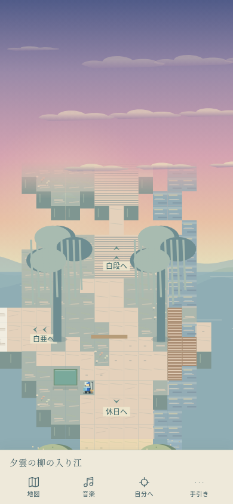
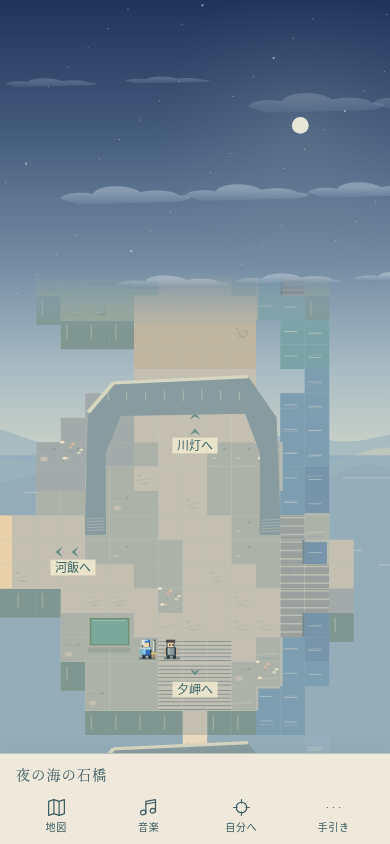
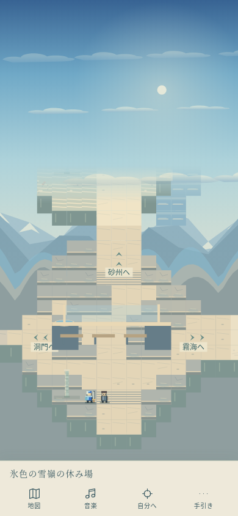
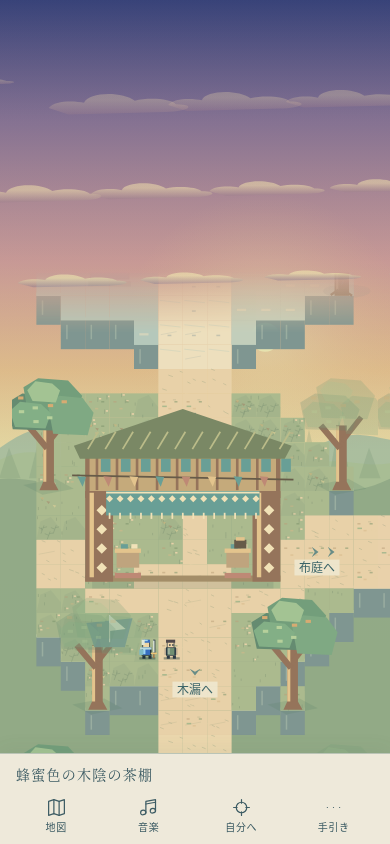
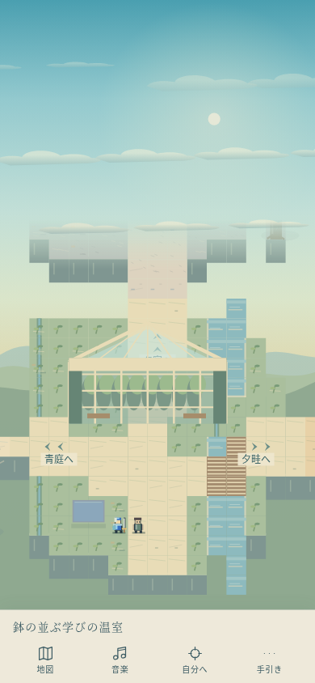
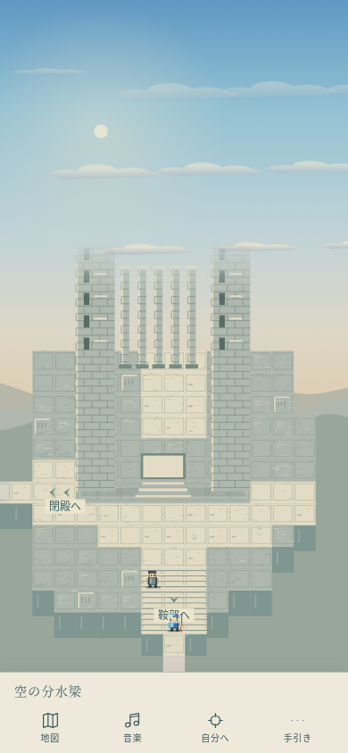

# 空の枝道 — 10×10、100枚を歩く（Issue #122）

制作者の訂正を採用し、**10マップ×10マップ＝100画面**とする。「40×40」は一画面の歩行グリッドの指定ではない。一画面は今までの**15×15タイル**、人物と道が見える共通等方倍率を維持する。既存33枚の位置と主要な周回を残し、未使用の67か所へ作者配置の画面を増設した。全体への固定画面採用は未決定。通常世界480×832・33地域・87施設・32NPC・全110曲と、旧モードは変更しない。

## 入り方と歩き比べる順路

試遊道標か手引きの「空の枝道へ（画面切替）」から入る。全画面で手引きの「元の場所へ戻る」、または入口の帰りの道標で、元の安全床・保持カメラ・曲へ戻る。

- 南の暮らしと空：集落→東の帰り並木→東の水の庭→南の釣瓶→西の草橋→西の果樹→南の茶棚。そこから東へ進むと、布庭・揚水輪・温室・乾いた器・桟橋・赤壁・白亜・夕雲の柳岸へ移る。
- 森から雪と夜の海：水の庭→南の釣瓶→南の揚水輪→東の温室→南の二橋→南の青緑の段畑。東へ、粉袋の風車→白い花→風見石→山の洞門→氷色の雪嶺→霧の海。南の川灯から西へ回れば、舟・星の列石・藤色の遠原・夕飯の宿・松影の道をたどれる。
- 北東の高地：以前の受水殿→温室→北の段畑→東の風車/遠原/列石/帝門/閉殿。その東から、分水梁→南の雪の鞍部→赤壁→夕空の入江へ下れる。
- 南の大周回：南側の6本の東西の道を、左右の外周と複数の縦道で往復できる。全部を順番に消化する必要はなく、気になる空や隣の地名を選ぶ。景色の間をつなぐ、静かな画面も残す。

BGMは既定OFFを守る。音楽を比べる時は一度ONにする。同じ曲の範囲は継続し、違う土地へ往復すると各地の曲へ戻る。手動選曲は同じcueの範囲で保ち、別の土地では地域曲に戻る。音量・SE設定は独立して保つ。

## 地理と描画の計画

既存33画面を北西へ残し、北東4画面・集落の南3画面・南側6行60画面を追加。全体俯瞰は**150×150タイル**。全100座標を埋めるが、全隣接辺を自動で開けず、崖や水辺・建物の回り道と、道幅の違う接続で進路を作る。辺の通れない場所は遷移しない。各画面の道と輪郭を再構成し、実際の水・干上がった溝・階段・橋・幹・建物の足元を衝突源にする。

`fixed-atlas-data.js`の67枚が役割・元地域・地形・空・曲・設備を保持する。`fixed-journey-data.js`の既存33枚と接続し、元の描画器・source solidを同じ等方変換で利用する。全体で**120点の建築/設備（76主物体＋44小物）、58種類の元オブジェ、20NPC**。元8画面の家2棟と植生も残る。設備を詰めて橋を塞がないよう、水車や軒の大きさ・小物の位置を調整し、岸には実際に通れる板道を追加した。通れない水を床に塗り替えて救済していない。花や葦の小さな装飾には通行を阻む足元を付けない。

`fixed-sky.js`の11構図は、淡い青空、青緑の光、金色の夕雲、珊瑚色の残照、桃色の空、藤色の薄明、藍の星空、白い霧、乾いた霞、氷色の雪、赤銅の夕空。雲の立体・裾の影、太陽/月のにじみ、星、遠い雪の層と霧を描き分ける。単なる地面の色替えや静止画像の貼り付けで終わらせない。従来の大きな青空も残す。光は画面の入場時から固定し、歩行で切り替わらない。画面送りは描き終えた空全体の補間なので、雲の内部alphaが先に出ない。

共通倍率 `min(.9,(stageW−24)/480,(stageH−24)/576)` と560ms五次補間を維持。タイル/人物の縦横別の引き伸ばしなし。15×15を保つため、390縦は約24px/タイル、320縦は約20px、844横は約16pxの以前の見やすさを維持する。100枚を一画面へ縮めて歩く方式ではない。俯瞰地図は小さい表示で文字幅を抑え、現在地をCSS寸法で描き、隣接先の正式名は44px以上のボタンで示す。

## 音楽と創作の境界

現行main全33地域の主曲を使用し、薄明の遠原、夜の森/河港、残照の赤壁、白亜の風化柱に既存の別曲を合わせ、**38cue（37曲の演奏＋閉殿の静けさ）**を配置。既存110曲の譜面・イベント・番号を変更しない。新曲/外部音源/音量規則は追加しない。水・木工・風・石・反響の距離音と、草/木橋/石/砂の足音も維持する。

水/干上がった設備の対応は残すが、同じ土地の過去未来とは確定しない。暮らしや幼い頃の幸福を偽物にせず、女神・裁き・生贄・帝国滅亡の答えは追加しない。元オブジェの文章を再利用する範囲に留める。全体固定画面化、画面別倍率、本番の地理・物語への採用は、遊んだ後に判断する。

## 全100画面・空・曲の台帳

|画面|元地域|役割|空|cue・曲名|設備|
|---|---|---|---|---|---|
|青い屋根への坂|空の生活集落|小さく登る。段の向こうに同じ屋根が再び見える。|従来の空|47:2 屋根の上の昼の食卓|植生と道|
|風の渡り道|空の生活集落|静かに通り抜ける間。高庭の全景をまだ渡さない。|従来の空|47:2 屋根の上の昼の食卓|植生と道|
|窓の開いた高庭|空の生活集落|見てきた青屋根の足元へ着く。暮らしの尺度が分かる。|従来の空|47:2 屋根の上の昼の食卓|家と暮らしの道具|
|空の段畑の畦|空の段畑|畦と階段を回り、水を配る高さを見る。|従来の空|48:2 段畑を渡す手の合図|空の段畑の休み場|
|黄昏の風車丘|黄昏の風車丘|粉袋と回る羽。登った道を夕色の中で振り返る。|従来の空|48:1 風車が数える粉の袋|丘の小さな風車|
|蒼い遠原の白い花|蒼い遠原|目立つ出来事を置かず、遠さを感じて通り抜ける。|従来の空|49:2 遠原に残る白い花|植生と道|
|間を測る列石|間を測る列石|器と水尺の反復が、人の背より大きく現れる。|従来の空|43:1 触れた後の間|間を測る巨石|
|帝都の外郭の足元|帝都の外郭|遠くで見た門の柱の間へ。設備の尺度が変わる。|従来の空|44:1 幾つもの門の向こう|帝都の外郭門|
|扉のない受水殿の庭|扉のない受水殿|狭い正面の先は閉ざされ、器だけが満ちている。|従来の空|39:2 自分の声に似ている（静けさ）|扉のない受水殿|
|空の分水梁|最後の器|旅で見た器の反復を、大きな梁の足元で見る。|blue|5:2 最後の防壁|最後の大きな器|
|糸杉の分かれ道|空の生活集落|目印を木々で隠し、登りと水辺への選択を作る。|従来の空|47:2 屋根の上の昼の食卓|植生と道|
|橋のたもと|空の生活集落|登りの道と水辺を結ぶ分岐。短い周回も選べる。|従来の空|47:2 屋根の上の昼の食卓|植生と道|
|水音の降り道|空の生活集落|高庭を後ろにして下る。流れを橋で越え、道の高さを変える。|従来の空|47:2 屋根の上の昼の食卓|植生と道|
|記憶の温室の庭|記憶の温室庭園|水盤とガラス越しの緑。北の畑と森市への分岐。|従来の空|45:2 ガラスの朝の水やり|記憶の温室庭園のガラスの家|
|木陰の布の市|輪を結ぶ森市|開いた軒と布、輪を運ぶ人の明るい広場。|従来の空|18:1 懐かしい異邦人|風を量る布店|
|木彫りの工房道|輪を結ぶ森市|市と同じ曲のまま、木工と茶の匂いの道を抜ける。|従来の空|18:1 懐かしい異邦人|枝窓の木彫り屋|
|霧の針葉樹林|霧の針葉樹林|見通しが細くなり、列石への脇道が現れる。|従来の空|17:1 濡れた石畳|植生と道|
|風鳴りの登山口|風鳴りの登山路|段を登り、岩の洞門の向こうに雪を見る。|従来の空|53:1 風を切る稜線|風鳴りの登山路の休み場|
|雪嶺を遠望する崖道|雪嶺の長い崖道|大鐘の余韻と青い雪。帝都へ続く登りの前の間。|従来の空|45:1 雪の彼方へ、鐘は渡る|雪嶺の長い崖道の休み場|
|薄明の雪の鞍部|雲の上の水尺|雪嶺と外郭の間を、細い段でつなぐ。|violet|41:2 風が先に知っている|雲上の水尺／使いこまれた受け皿|
|空の麓の集落|空の生活集落|旅の入口。窓と洗濯物を背に、木立へ向かう。|従来の空|47:2 屋根の上の昼の食卓|家と暮らしの道具|
|帰り風の並木|空の生活集落|寄り道を終えて集落へ回る。屋根と木立を帰路の角度で見る。|従来の空|47:2 屋根の上の昼の食卓|植生と道|
|水路を渡る庭|水を渡す庭|空の集落から、水を受け渡す土地へ。|従来の空|42:1 器から器へ|植生と道|
|水を受ける七段|水を渡す庭|器と溝をたどり、流れの用途を歩いて見る。|従来の空|42:1 器から器へ|水を渡す三つの器|
|水の失せた七段|水の失せた七段|同じ器と溝。底の音と水位の跡が残る。|従来の空|42:2 同じ溝に砂がある|水を失った七段|
|白い舟の原|白い舟の眠る原|乾いた白い地面に、手入れされた舟がある。|従来の空|27:1 海のいなくなった港|陸に残る舟|
|青い灯の休み処|青い灯の宿道|鍋と椀のそばで、次の土地へ向かう間を置く。|従来の空|30:2 湯気の向こうの故郷|青い灯の宿|
|風の草原の分岐|風の草原街道|明るく速い風。登山路と赤砂へ道が分かれる。|従来の空|54:2 草原、青い風の助走|植生と道|
|赤砂の風窓|赤砂の風窓台地|地層を回り、岩の窓に海の色を見つける。|従来の空|54:1 赤砂を渡る翼|風窓の岩門|
|赤壁を回る切通し|赤い裂け目の街道|裂け門をくぐらず、足元の回り道も選べる。|copper|36:1 残照を追いかけて|風を通す裂け門／陸に残る舟|
|果樹の窓辺|空の生活集落|帰路の家を別の高さから見る、南の旅の入口。|blue|47:2 屋根の上の昼の食卓|窓の開いた家／使いこまれた受け皿|
|草の小橋|道のむこうの並木道|木々の切れ目から、畦と水車の影を見る。|blue|50:1 木陰から道のむこうへ|道端の水尺|
|釣瓶の畦道|水を渡す庭|水を上げる輪の脇で、下の庭への分岐を選ぶ。|mint|42:1 器から器へ|三段の揚水輪|
|下の庭へ流す階段|水を渡す庭|使い終えた水を次の庭へ渡す、静かな通路。|従来の空|42:1 器から器へ|植生と道|
|水位跡の降り道|水の失せた七段|同じ幅の橋と段を、流れのない溝に沿って下る。|従来の空|42:2 同じ溝に砂がある|植生と道|
|潮風の葦の板道|潮風の葦原|曲がる板道を選んで、葦の中の水を越える。|従来の空|51:1 葦の間を舟がほどく|葦を束ねる観察台|
|木陰の河港|木陰の河港街|橋の先に食堂。舟と水車のある生活の岸。|従来の空|52:1 木陰の港の寄り道|河岸の昼の食堂|
|潮だまりの回り道|潮の石橋海岸|海へ直行せず、岩の縁と潮だまりをたどる。|従来の空|52:2 潮の石橋、夕べの道標|植生と道|
|潮の石橋|潮の石橋海岸|岩の橋を人の尺度で見上げ、赤砂へ戻る。|従来の空|52:2 潮の石橋、夕べの道標|海の大きな石橋|
|入江へ降りる白段|光の入り江|赤い岩から柳の水面へ、光を変えながら下る。|coral|46:2 柳の色は水へほどける|光の入り江の休み場|
|蜂蜜色の木陰の茶棚|輪を結ぶ森市|茶の棚の明るさと、奥の木立の暗さを通り比べる。|amber|18:1 懐かしい異邦人|木洩れ日の茶棚／陸に残る舟|
|布の乾く小さな庭|輪を結ぶ森市|布の間を抜ける短い生活の通路。|coral|18:1 懐かしい異邦人|風を量る布店／道端の水尺|
|揚水輪の細い路地|水を渡す庭|器へ送る水の高さを、輪と段で読む。|mint|42:1 器から器へ|三段の揚水輪|
|ガラスに映る池|記憶の温室庭園|温室の開いた内側と水辺の外周を歩ける。|blue|45:2 ガラスの朝の水やり|記憶の温室庭園のガラスの家／道端の水尺|
|器を乾かす七段の縁|水の失せた七段|同じ水尺と橋が、音の少ない溝に続く。|amber|42:2 同じ溝に砂がある|使いこまれた受け皿|
|白い桟橋の下の道|白い舟の眠る原|海のない足元と、高い桟橋の影を見上げる。|amber|27:1 海のいなくなった港|高い桟橋の影|
|裂け目の二つの曲がり角|赤い裂け目の街道|一度門を隠し、次の曲がりで再び見せる。|copper|53:2 裂け目を走る銅の拍|道端の水尺|
|赤砂の細い石段|赤砂の風窓台地|岩の窓を横から見て、台地の縁を回る。|copper|54:1 赤砂を渡る翼|風窓の岩門／使いこまれた受け皿|
|白亜の風化柱|白く乾いた高原|白い露頭の間を静かに通る、到着前の間。|haze|35:2 風に削られる白|風化した白い柱|
|夕雲の柳の入り江|光の入り江|水面の長い反射を、柳越しに追う。|coral|46:2 柳の色は水へほどける|光の入り江の休み場／使いこまれた受け皿|
|木洩れ日の昼休み|輪を結ぶ森市|名所を置かず、茶棚と工房の間を休ませる。|blue|18:1 懐かしい異邦人|陸に残る舟|
|削り屑の匂いの軒|輪を結ぶ森市|木彫りの軒を回ると、先の河岸が少し見える。|amber|18:1 懐かしい異邦人|枝窓の木彫り屋|
|川をくみ上げる輪|木陰の河港街|板道から揚水輪の回る生活の岸へ着く。|rose|52:1 木陰の港の寄り道|河港の揚水輪／使いこまれた受け皿|
|二つの橋の水路|水を渡す庭|流れを二度渡り、水の向きを足で覚える。|mint|42:1 器から器へ|道端の水尺|
|静かな分水の庭|静かな分水嶺|同じ量を送り続ける輪の脇から先へ進む。|haze|38:2 次の人が来るまで|静かな分水器|
|返事を待つ壁の脇|間を測る列石|壁の表と裏で、見えていた列石の間を測る。|violet|43:1 触れた後の間|返事を待つ壁／陸に残る舟|
|草に埋まる門の肩|風の草原と埋もれた門|通り門の用途を残す低い石を越えて回る。|rose|40:2 草の向こうへ|埋もれた門柱／道端の水尺|
|乾いた高原の折返し|白く乾いた高原|白い地面の小さな起伏を目印に歩く。|amber|35:1 白い岸の記憶|風化した白い柱|
|空を置く砂州|空を映す浅瀬と砂州|浅瀬を渡らず、砂州と橋を選んで進む。|blue|50:2 砂州に置いた空の余白|空を映す浅瀬と砂州の休み場／道端の水尺|
|点描の休日の岸|点描の休日河岸|小舟と花の明るい岸で、夕色の長い道を休む。|rose|47:1 日曜日の小舟のワルツ|点描の休日河岸の休み場／使いこまれた受け皿|
|倒れた杉の木陰|霧の針葉樹林|大樹の側を回り、狭くなった見通しを抜ける。|mist|17:1 濡れた石畳|倒れた大樹|
|香草を干す茶棚|輪を結ぶ森市|森市のにぎわいを、茶と香草の小さな軒へ戻す。|amber|18:1 懐かしい異邦人|木洩れ日の茶棚／道端の水尺|
|洗濯物の向こうの道|道のむこうの並木道|布の隙間に次の段畑が見える、暮らしの通過路。|coral|50:1 木陰から道のむこうへ|窓の開いた家／使いこまれた受け皿|
|青緑の段畑の水口|空の段畑|水口と畦の段を回り、畑の高さを比べる。|mint|48:2 段畑を渡す手の合図|空の段畑の休み場|
|粉袋を数える風車|黄昏の風車丘|人の背丈の袋と大きな羽の尺度を比べる。|amber|48:1 風車が数える粉の袋|丘の小さな風車／使いこまれた受け皿|
|白い花の何もない道|蒼い遠原|仕掛けを増やさず、遠原を抜ける時間を残す。|blue|49:2 遠原に残る白い花|陸に残る舟|
|風見石へ曲がる尾根|風見石の小さな頂|小さな石を見つけて、雪の方角へ折れる。|violet|28:1 峠を越える風|風見石|
|山の洞門の敷居|風鳴りの登山路|大きな洞門の足元から、細い登りに入る。|violet|53:1 風を切る稜線|風鳴りの登山路の休み場／使いこまれた受け皿|
|氷色の雪嶺の休み場|雪嶺の長い崖道|雪を見たあと、低い腰掛けから道を振り返る。|glacier|45:1 雪の彼方へ、鐘は渡る|雪嶺の長い崖道の休み場／道端の水尺|
|霧に沈む海の席|潮の石橋海岸|海へ突き出た足場から、見えない先を待つ。|mist|52:2 潮の石橋、夕べの道標|潮を待つ石の席|
|松影の青い夕道|霧の針葉樹林|枝が空を隠し、木立の先の灯りだけを予感する。|indigo|32:2 月影の隊商|陸に残る舟|
|便りを待つ灯の窓|空の生活集落|旅の用事の気配を残す、小さな明るい窓。|violet|47:2 屋根の上の昼の食卓|風待ちの便り棚／道端の水尺|
|夕飯の鍋のある宿|青い灯の宿道|夕色の道と温かい食堂の間に間を置く。|amber|30:2 湯気の向こうの故郷|青い灯の宿|
|ばら色の風の草原|風の草原街道|速い風と曲の先に、開けた草の道を見せる。|rose|54:2 草原、青い風の助走|風の草原街道の休み場／道端の水尺|
|雲の縁の小さな円環|雲の上の水尺|人の背より大きい輪と、遠い雲の尺度を比べる。|violet|41:2 風が先に知っている|雲の縁の円環／使いこまれた受け皿|
|藤色の遠原の帰り道|蒼い遠原|同じ白い花を薄明で見直す、静かな帰り道。|violet|29:2 帰らぬ光のさざ波|植生と道|
|星明かりの列石の間|間を測る列石|石の表面を見尽くさず、空に続く高さを残す。|indigo|43:1 触れた後の間|間を測る巨石／道端の水尺|
|陸の舟の骨と夕風|白い舟の眠る原|水の設備の記憶を、乾いた舟の形へつなぐ。|coral|27:1 海のいなくなった港|陸の船の骨／使いこまれた受け皿|
|船着場のもう一つの待合|白い船着場|遠い旅の後に、人の用事がある岸へ戻る。|blue|30:1 午後の茶と旅話|船着場の待合|
|川の窓に灯る明かり|木陰の河港街|窓と水面の小さな灯をたどる、夜の生活道。|indigo|22:1 星明かりの橋梁|舟の窓辺の家／使いこまれた受け皿|
|雨上がりの針葉の小径|霧の針葉樹林|木立に隠れた短い通路で、開ける前の間を取る。|mist|17:1 濡れた石畳|陸に残る舟|
|青い屋根の向こうの庭|空の生活集落|出発の青屋根と似た家を、別の暮らしの尺度で見る。|blue|47:2 屋根の上の昼の食卓|空の生活集落のガラスの家|
|鉢の並ぶ学びの温室|記憶の温室庭園|鉢と水盤の整った庭を、開いた前面から歩く。|mint|45:2 ガラスの朝の水やり|記憶の温室庭園のガラスの家／使いこまれた受け皿|
|夕日に向かう畦の段|空の段畑|畦を上り下りし、振り返る水口の色を変える。|coral|48:2 段畑を渡す手の合図|空の段畑の休み場／道端の水尺|
|金色の粉の丘|黄昏の風車丘|長い羽の影と袋を見て、次の白い土地へ向かう。|amber|48:1 風車が数える粉の袋|黄昏の風車丘の休み場|
|桃色の白い露頭|白く乾いた高原|白い岩が夕色を受ける、静かな高原の間。|rose|35:1 白い岸の記憶|風化した白い柱／陸に残る舟|
|空を渡す細い水路|静かな分水嶺|小さな水路が画面の外へ続く、配水の道。|violet|38:2 次の人が来るまで|空を渡る細い水路／道端の水尺|
|夕焼けの葦の束ね場|潮風の葦原|水面を避ける板道から、葦を干す足場へ着く。|rose|51:1 葦の間を舟がほどく|葦を束ねる観察台|
|河岸の夕飯の窓|木陰の河港街|明るい窓を一度脇へ回り、海の音へ出る。|coral|52:1 木陰の港の寄り道|河岸の昼の食堂／道端の水尺|
|夜の海の石橋|潮の石橋海岸|同じ大きな橋を、星と水面の暗さで見直す。|indigo|52:2 潮の石橋、夕べの道標|海の大きな石橋／使いこまれた受け皿|
|水辺へ続く並木|道のむこうの並木道|南の外周を静かに結ぶ、木陰の長い道。|mist|50:1 木陰から道のむこうへ|道のむこうの並木道の休み場|
|輪を運ぶ森の広場|輪を結ぶ森市|森の暮らしの輪と、遠くの大きな配水輪を比べる。|amber|18:1 懐かしい異邦人|森市の輪の台／道端の水尺|
|夕雲を待つ船着場|白い船着場|出発にも帰路にも見える、生活のある港。|coral|30:1 午後の茶と旅話|船着場の待合／使いこまれた受け皿|
|柳と水草の腰掛け|光の入り江|長い周回の途中に、小さな休息の余白を置く。|rose|46:2 柳の色は水へほどける|水辺の腰掛け|
|水の上の点と光|点描の休日河岸|点描の岸と流れの粒を、ゆっくり通り抜ける。|blue|47:1 日曜日の小舟のワルツ|点描の休日河岸の休み場／使いこまれた受け皿|
|夕空を映す砂州|空を映す浅瀬と砂州|水に入らず、砂の舌と橋をたどる。|amber|50:2 砂州に置いた空の余白|空を映す浅瀬と砂州の休み場／陸に残る舟|
|静かな分水梁の庭|静かな分水嶺|用途どおり続く配水設備を、夜の人間の尺度で見る。|indigo|38:2 次の人が来るまで|帝都の分水梁|
|白い霧の葦の腰掛け|潮風の葦原|霧の中で板道を選び、外周の帰り道を見つける。|mist|51:1 葦の間を舟がほどく|水の分かれる腰掛け／使いこまれた受け皿|
|夜の河港の布屋|木陰の河港街|乾く布と窓の灯を目印に、旅の最後の曲がりを作る。|indigo|22:1 星明かりの橋梁|木陰の布屋／道端の水尺|
|夕空の岬の回り道|潮の石橋海岸|海の大きな空を見て、別の道へ折り返せる岬。|coral|52:2 潮の石橋、夕べの道標|海の大きな石橋|

## 検証と未実施

rulesは100枚すべての全床BFS、10×10の全座標、全辺/全幅の対応、全オブジェのsource solid/等方変換/調べ口、NPCと着地点、全主曲と旧110曲のハッシュ、全接続の往復と入力破棄を検査する。孤立床を削って通したことにはしない。

browserは**320×568・390×844・430×932・844×390で全100枚を111回の通常フィールド出口タップから一周**する。390縦では新67画面の全102設備を実際に調べ、native AudioContextのbuffer長/loop開始数から38地域cueの再生と継続を確認する。全11空の0%/100%端点が通常描画に一致する回帰も検査。旧8/33枚の全既存ブラウザ回帰、通常世界・旧モード・音楽の負荷/連続性検査は残す。

CIは`core / landscapes / journey / fixed / atlas`の5グループに分割し、**全グループ成功を集約したbrowser**とrulesをマージ条件とする。検査を省かず、現在の単一ジョブ50分に新しい100枚の検証を押し込まない。`BROWSER_GROUP=atlas npm run test:browser`等で個別実行、未指定は全検査。artifactは`atlas-browser-evidence-<group>`、新しいPNG/JSONは`fixed-atlas/`に保存する。

最新head/ローカル/CI/main/Pages/公開起動の結果はPRに記録。**未実施**：実機iPhone/Safari、実耳、独立監査、人間の旅情の受入、低性能端末の長時間負荷/電池/セーフエリア。Chromiumのモバイルエミュレーションと区別する。

390縦・実際の歩行からのキャプチャ：

