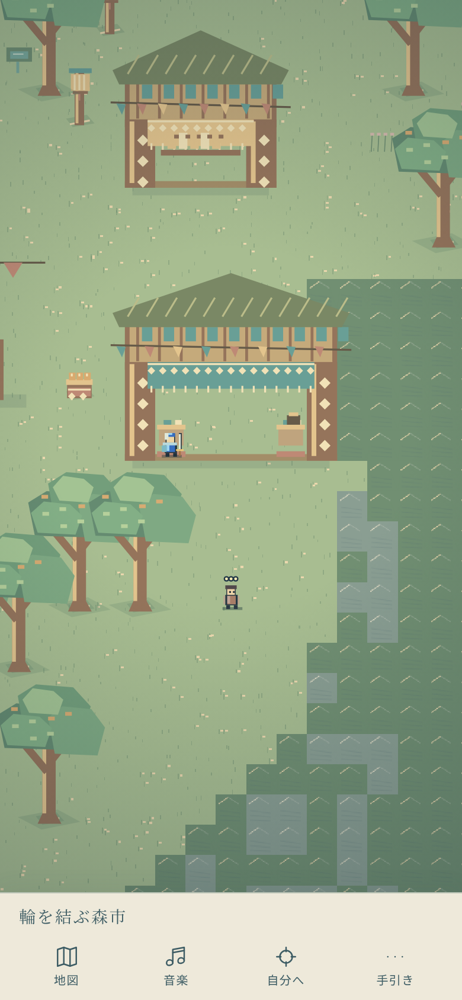

# 輪を結ぶ森市

採用根拠：制作者の「楽しげだったりエキゾチックな森の街だったりそういうのも欲しい」。最新main 78cdff2を基準に、序盤の草原の主要な広場を森の生活圏へ整える。楽しさは本物として残し、裏の恐怖や正史の答えを追加しない。

## 受入と実装計画

- 現在の巡礼13地域・43区間を保ち、2番目の地域を「輪を結ぶ森市」とする。木々の間の茶屋・布店・木彫りの家の3地点と住人2人を追加。既存の輪遊びを中心にした回遊できる広場。
- 狭い立ち枯れの道ではなく、緑と果実、木彫りの軒、色布、低い座卓、茶器で場所の違いを描く。現実の民族・宗教の記号や借用画像を使わず、独自の架空の街とする。
- 木は有限の配置と可視範囲で描画。幹は実体1マス、葉は頭上の絵。街道・施設入口・NPCの周囲を避け、主人公の描画を覆わない。水や崖を陸に変えず、経路探索・速度・カメラ倍率は変更しない。
- 茶屋の湯沸かし、木の店先の音を既存の近接音へ統合。森市は笛/ハープの明るい既存曲から選び、90曲とBGM/SEの設定・音源上限を維持。
- 全歩行域の接続、新旧全地点の往復、幹と柱の衝突、開いた前庭、配置の重複を検査。Chromiumで街まで歩き、店・住人・現地タップ・描画・音楽室と既存回帰を確認。iPhone実機・実耳・独立監査は未検証として残す。

本変更は中リスクの局所的な景観・衝突配置・会話・選曲。地形の寸法と既存の巡礼ルート、古いatlas/classic/prototype、保存キー、戦闘/クエスト/セーブを追加しない原則は維持する。

## 実装と試遊の入口

森市は13地域の2番目。船着場から北へ、東の街道を歩くと布店から広場、木彫り屋と茶棚へ入る。地図の「輪を結ぶ森市」からも歩ける。店は柱をタップして調査し、開いた前庭では地面タップで歩ける。森市のBGMは必要に応じて音楽をONにして聴く。

最終配置は幹31本、3店、住人2人の追加。既存の輪の台は小さな木の台へ再描画し、輪を触った音は維持。本文で楽しさを恐怖の正解に読み替えない。全37地点・12人の往復、全歩行域接続、重複、陸地内の建物、通路、幹・柱・座卓の衝突を検査し、161件のアサーションが成功。ブラウザでは3店と2人を訪ね、床と柱、幹への実移動入力、地域の選曲を確認。長い巡礼のブラウザ検査は時計を進めるため、人間の実時間の楽しさの検証とは区別する。

全体回帰、CI、マージと公開結果はPRの最終記録を参照。iPhone/Safari実機、実耳、低性能端末、独立監査は未確認。
