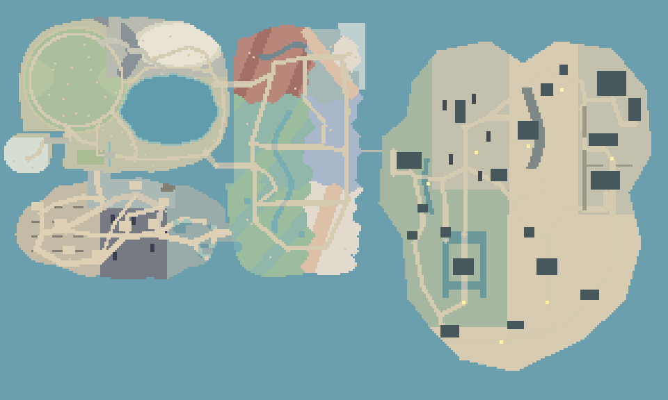
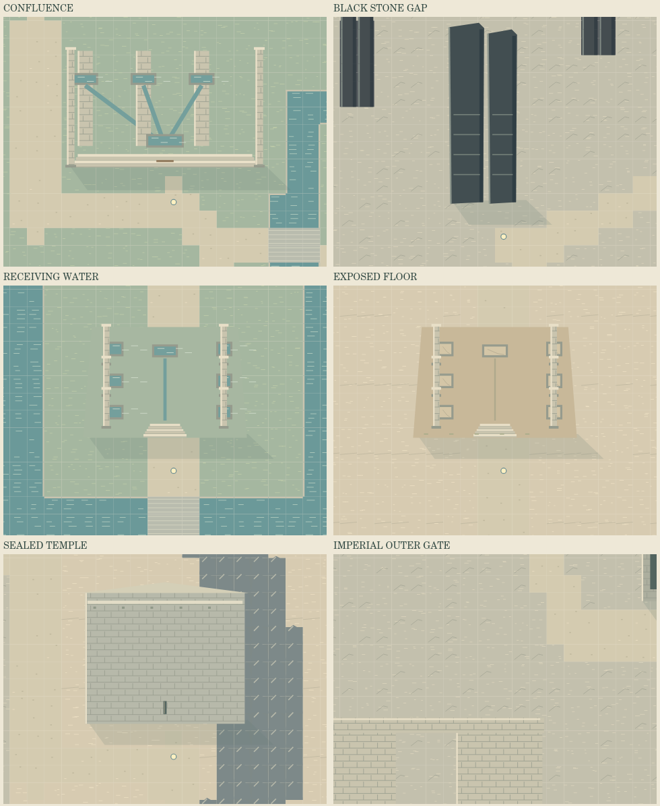
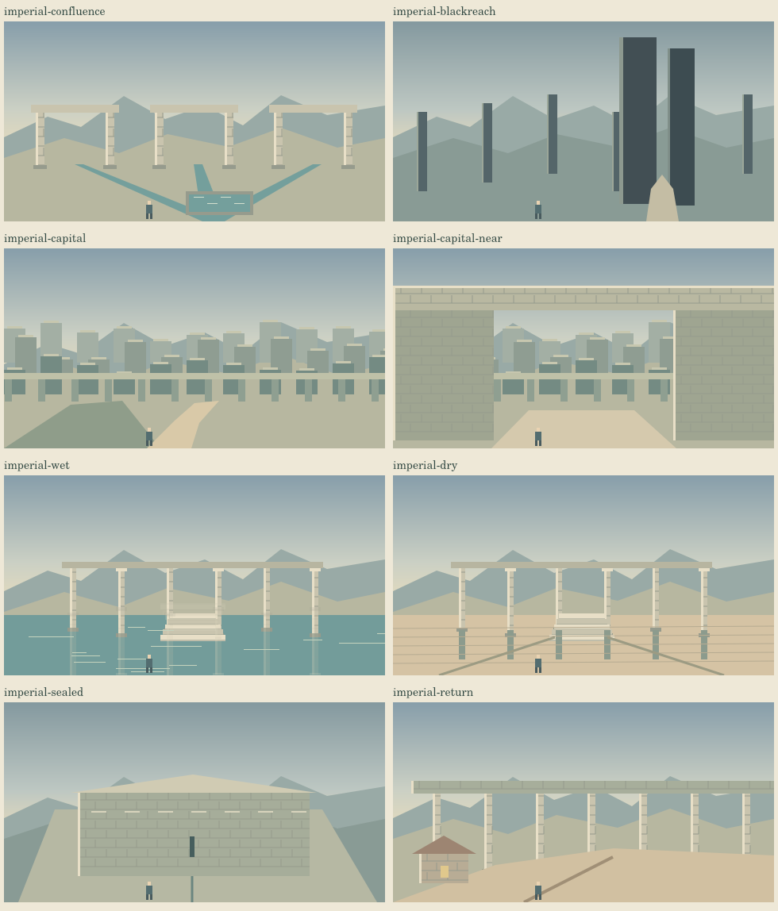

# 水路と神殿、遠い帝都跡の試遊サンプル（#78）

## 実装前の技術計画

基準：main b843d2524a0ded5357dcb54ff1612c9f43ffb850。制作者が2026-10-28に現在マップの拡張、美術、音、神殿比較の実装を依頼。

- 既定journeyを176×136から320×192へ東側に拡張。旧領域の地形と全地点を維持し、指定した東の接続橋だけを旧水域へ追加する。classic/prototypeには触れない。
- 新規データ・地形・近景描画・遠望を独立モジュールへ分離し、既存経路探索そのものは変更しない。新しい水路・崖・列石は通行不可。橋・道・施設入口を明示してから全地点を始点から検査する。
- 古い地形データを比較し、接続橋以外で変更がないこと、旧施設・NPC・遠望を維持していることを検査する。旧世界データの配列の並び・保存キー・開始点も維持。
- 新規建造物の実体は通行不可。庭と調査地点は非閉塞。大きな建造物の南側に到達可能な入口を用意する。遠望は独立した480×252のCanvas絵として既存の任意表示へ統合し、通常の徒歩画面にも同じ建築意匠を描く。
- 新地域すべてに意図的なBGMプールを割り当てる。専用3組6曲を既存ライブラリ末尾へ追加し、旧曲の番号・内容を保持。選曲は既存の2.2秒滞在/12秒保持、合成・音量・停止処理を利用。近接音は既存の上限2音源・減衰・SE設定へ統合し、新しいAudioContextやタイマーを作らない。
- 調査による小さな反応はページ内のみ。物語進行・セーブ・世界全域の状態変化・生贄の断定・敵・戦闘を作らない。動きは低頻度で小さく、Reduced Motionでは静止する。
- 既存テストの寸法依存は寸法定数から取得する形へ変更し、断言や試遊対象は削らない。新規経路/画面/調査/遠望/音源検査を追加する。
- mainへは統合せず実装PRを作り、rules/browserの結果を確認して昼ランへ渡す。自己検査と独立監査、ChromiumとiPhone実機、音源合成と実耳を区別する。独立監査・端末試遊は残件。

## 比較したい体験

水の流れる神殿と同じ構造の干上がった神殿、複数の流れが合わさる神殿、無音の閉じた神殿を、実際に歩いて比較する。石・水位線・足場・音の反応から違いを感じ、本文で真相を説明しない。

帝都跡は遠方の目的地。街道・小さな暮らし・旧水路・列石・尾根を経て、外壁の最初の一部が見え、最後に門前と巨大な街区へ至る。地名と任意遠望を使い、操作や実験のメタHUDは増やさない。

## サンプルと正史

これらの場所と短文は比較用の風景。女神の実態、裁きの内容、生贄、帝国の歴史の確定ではない。水位の対比は同時に歩ける二つの景観標本として実装し、時間操作・季節切替や物語上の同一地点の前後変化は実装しない。

## このブランチで実装したもの

320×192、合計25地域。新たに7地域・19地点・8人・8遠望・8近接音源・3組6曲。既存78地点・169人・18地域・34遠望はデータを変更していない。

| 地域 | 地図上の中心 | 比較するもの |
|---|---|---|
| 合水の巡礼路 | 198,84 | 三方の流れと丸い器、現在の暮らし、低い輪の台 |
| 返響の列石谷 | 222,61 | 二枚石の間、有限の列石、石庭の順序と短い反響 |
| 空槽の尾根 | 262,32 | 水のない高い槽、水尺、帝都の最初の遠景 |
| 遠い帝都の残骸 | 293,80 | 門前、巨大な高壇、顔のない壁龕、空の貯水庭 |
| 水を受ける庭 | 222,145 | 六柱、左右の槽、水が隠す床と舟の輪 |
| 水を失った庭 | 262,145 | 同じ六柱と槽、露出した底と七段の階段 |
| 帰り舟のない街道 | 240,164 | 高い桟橋の下を歩く帰路、横断橋、小さな宿 |

### 試遊の入口

統合後の既定 `/` と `?journey=1` に追加される。開始点・4道具は同じ。
地図の「合水の巡礼路」を選ぶと、既存の玻璃都から東の橋を渡って歩く。
最初の神殿は (190,73)〜(201,80)、入口 (196,82)。施設を地図か現地で選ぶと調査し、
再調査では別の短文と局所の模様が変わる。セーブや世界進行は持たない。

次に列石谷→尾根→帝都跡、または南の水庭→干上がった庭→街道の宿を選べる。
最短で帝都門前まで321マスの合法経路がある。歩行速度の設定は変更していない。
渡河は実際の橋。門の中央は通れ、両脇の石積みは当たる。列石・岩壁・水は歩けない。
屋外は0.8のまま。新しい強制ズーム・常設HUD・クエスト説明は追加していない。

### 音と画

- 「二つの受水庭」：器から器へ／同じ溝に砂がある。同じ旋律を使い、音階・速度・音の長さ・伴奏の厚みを変える。
- 「応答を待つ石」：触れた後の間／扉のない返事。打楽器を鳴らさず、薄い音と短い余韻を中心にする。
- 「帝都の遠い門」：幾つもの門の向こう／帰り舟のない街道。柔らかいホルンとハープ。行きの荘厳さと帰りの物悲しさ。
- 全6曲は音楽室で選べる。原曲68＋既存追加16＋今回6＝90曲。BGM初期OFF、SE初期ON、独立音量と保存キーは維持。
- 8か所に既存の滴・石・木・反響・湯沸かしの近接音。反響は黒石地域に限定。閉じた応答殿には反復環境音を置かない。
- 全景は新たなコード製のドット絵。外部音源・画像・CDNを使わない。2Dの石積み・水路・有限の遺構として描き、巨大な自律神や画面端末を置かない。

これらのPNGは実装したCanvas描画関数をローカルのCanvasで実行した美術確認画像であり、ブラウザー操作のスクリーンショットではない。

## 検証と残件

- 変更前：`npm run check` 134件成功。
- 変更後：既存134件と新規6件の計140件成功。JS構文検査、全歩行マスの接続、新旧全地点の往復、地形・衝突、25地域の音楽、既存2世界とミニ、音包絡線、入力を含む。
- 旧176×136の地形は、指定橋 (173,72)/(174,72)/(175,72) を除いてSHA-256で基準mainと一致。旧地点・NPC・地域・遠望の全レコードも比較して一致。
- テストにあった旧寸法・旧地点数・旧音源数は、新寸法への置換と旧データの抽出確認へ更新した。旧小マップ用の面積比率制約は今回の拡張に合わせ65,536マス以内という明示上限へ変更。試験の削除はない。
- 全7地域の曲IDと6新曲は既存合成器で有効。原曲と既存追加曲の順序は維持。音量・余韻の実耳評価は行っていない。
- 地形チャンクのキャッシュ上限42、音楽ループキャッシュ上限2、近接音上限2を保持。旧地形の全量再描画は追加しない。
- 8遠望と6近景を描画し画像で確認。神殿への現実時間の徒歩、再調査、全遠望の実Canvas、音楽室の6新曲を確認するブラウザー検査を追加。
- ローカルの `npm run test:browser` はChromium本体がなく起動前に停止。インストーラーのダウンロードが空・不正なZIPで失敗した。ブラウザー回帰成功とは扱わない。PR headのrules/browserで再確認する。
- 自己点検：新旧全地点の可達性・不変条件の検査に失敗なし。独立監査は未実施。iPhone/Safari実機、タップの感触、発熱・電池・Safari音声、音の不気味さ・旅の面白さは未検証。

### 昼ランと試遊で確認すること

1. PR headのrules/browser成功、mainとの衝突なしを確認する。
2. 地図→東の橋→合水神殿への実歩行、現地タップによる調査・再調査を確認。
3. 水庭と乾いた庭の柱・水尺・舟階段の対応、湖水と橋の通行性、帝都の門の左右の衝突を確認。
4. 音楽をONにして水庭／乾いた庭、列石／帝都／帰路を聴き比べる。SE OFF・音量0も確認。
5. 任意遠望の開閉、4道具、320px縦・390px縦・844px横での画面と操作を確認。
6. 議論の感触を比較し、正式採用する神殿の構造や怖さは別に判断する。今回の風景を理由に生贄や女神の能力を確定しない。
