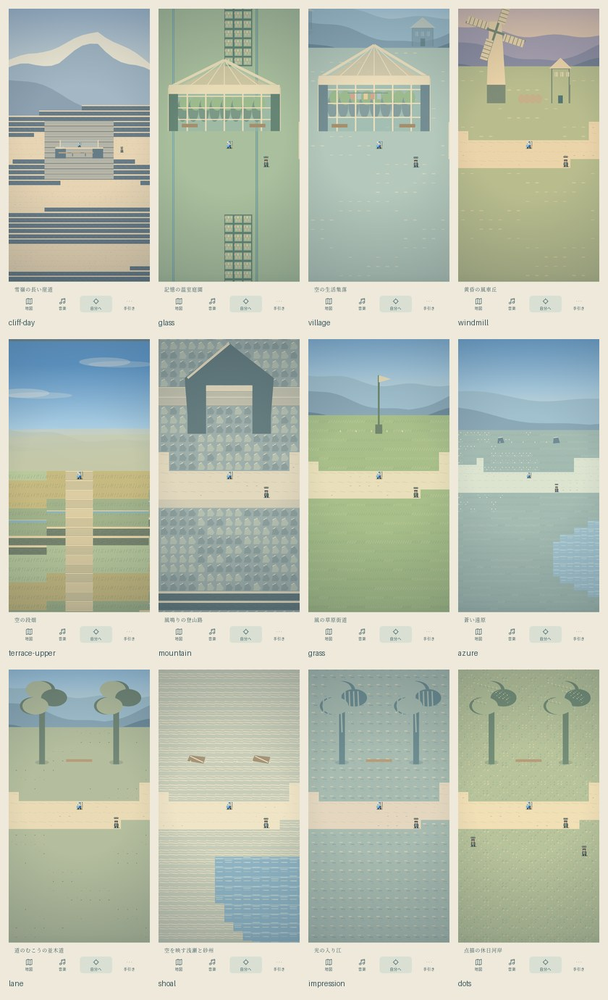
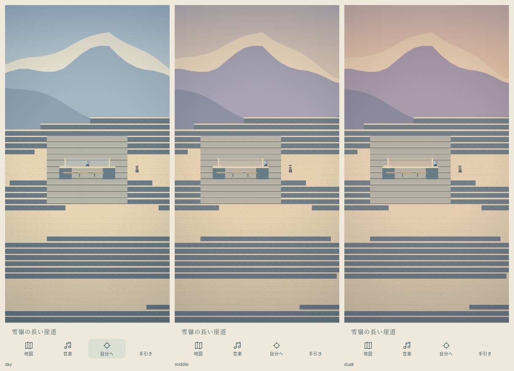

# 西側の空と十二の土地 — Issue #106

2026-11-04 JST。採用元：[Issue #106（本文と追記2件）](https://github.com/hane-san/ARPG-02-retrostyle/issues/106)。作業は `feat/106-western-sky`。以下はこの試作の配置・技術計画と検査台帳であり、人間の鑑賞承認ではない。

## 統合と短い技術計画

1. 最新main `b94901f`、#99 / #100 / #103の六つのdetour、#98のUI、#101の追従を基準にする。#93は提案なので全案の採用にはしない。PR #105 `ae866c5` を作業ブランチへmergeし、通常の#96/#101追従と `?camera=deadzone` を併存。カメラ本体・既定方式は変更しない。
2. 480×288の既存座標・湖・巡礼43区間を保ち、南西外周を480×832へ伸ばす。左右2本の幹線・横断路と、温室〜畑の間／遠原南の近道で回遊する。旧「黄昏の丘」「湖畔」の地域13/15を風車丘／印象派水辺の入口として統合し、元の道・木・岸・調査地点も残す。東の小さな頂は短い寄り道、新しい西の登山路は別の長い山道。十の新IDで計29地域。
3. P0=雪嶺崖道＋滞在時間による青空→夕暮れ＋大鐘と地域音楽。その後、温室・集落・風車・段畑、山・遠原・写真集的な道／砂州、印象派・点描の順に形を作り、接続・衝突・実画面を詰める。遠景は世界座標の開口へマスクし、地形チャンクと建築を前に描く。画面固定の背景帯を追加しない。
4. 歩行・A*は既存の寸法対応を使用。水・空・崖は通行不可、建築のsolidと描画の足元を一致させ、全床の連結性と全地点／NPCの往復を検査。段畑の石垣は実際に固体、段間の階段だけ通れる。
5. 独自旋律・拍節・和声・編成を持つ32小節、約61〜120秒の十二曲。従来90曲のIDを不変に保ち追加。地域の初回主曲、650msの境界確認・1600ms保持、1.2秒の音量フェードと既存の最新要求優先を使う。BGM既定OFF、音量・SE・音楽室は維持。
6. 崖道は作者指定.46、蒼い遠原は地域全体の.6で安定させ、他の新景観は.8。既存の滞在／離脱ヒステリシスを使用し、物体ごとの伸縮は追加しない。空の開口は必要な地域で北の未使用地8マスまで延ばし、到着位置から奥行きを読めるようにする。
7. 静的な地面／点描は既存16タイルチャンクへキャッシュ。空・風車・反射・雲影だけ可視範囲で描く。縦長地図は画面高に収め、地域ボタンも残す。変更前後を同じviewportで計測する。旧モードも同じ回帰スイートを通す。

## 地域・曲台帳

全域は自由歩行。代表入口=地図の地域ボタンの到着位置。色だけで区別せず、下記の地形・物体・生活・音を組み合わせる。実装状態は検査結果の欄で確定する。

|順|土地／地域ID|範囲 x,y,w,h・代表入口|実装種別と形／空の方式|主曲ID・曲名・BPM／長さ|
|---|---|---|---|---|
|1|雪嶺の長い崖道／19|4,290,232,80 → 116,345|新規。長い折返し崖道、手すり・腰掛け、三層の雪嶺。世界の空の開口＋夕映え|45:1 雪の彼方へ、鐘は渡る・64／120秒|
|2|記憶の温室庭園／20|8,380,104,55 → 60,412|新規。大ガラス骨組み、植物、固体花壇、作業路と水盤。ガラス・水の空の反射|45:2 ガラスの朝の水やり・78／74秒|
|3|風の草原街道／21|125,520,105,60 → 177,549|新規。風下へ向く草、農家、丘の開口、雲影|46:1 丘を越える青い便り・114／67秒|
|4|光の入り江／15|8,750,104,65 → 60,788|旧湖畔の地域を拡張改修。色面の水、柳と岸、反射。旧岸道も保存|46:2 柳の色は水へほどける・80／96秒|
|5|点描の休日河岸／22|125,750,105,65 → 176,787|新規。静的な色点群、木陰、水盤、休日の住人。水と陸で点の密度を変える|47:1 日曜日の小舟のワルツ・94／61秒|
|6|空の生活集落／23|125,380,105,55 → 176,413|新規。三軒の家、開いた食堂と透明ピラミッド、洗濯物。霞んだ浮遊住居|47:2 屋根の上の昼の食卓・86、5拍子／112秒|
|7|黄昏の風車丘／13|8,445,104,55 → 60,477|旧黄昏丘の地域を拡張改修。大小三つの風車、粉袋、丘の空。旧ひとつ木も保存|48:1 風車が数える粉の袋・102、6拍／113秒|
|8|空の段畑／24|125,445,105,65 → 176,484|新規。湾曲した畦と固体石垣、見える階段、緑／黄金／水張り畑、水門と住人。空の開口と雲影|48:2 段畑を渡す手の合図・98、6拍／118秒|
|9|風鳴りの登山路／25|8,520,104,60 → 60,550|新規。石の段差、折返し、洞門、風除け。雪嶺の観照と違う近景の山|49:1 次の折り返しの空・124／62秒|
|10|蒼い遠原／26|4,590,232,80 → 118,631|新規。幅232の低草原、白い花のまとまり、浅い水、休息石、霞む稜線と雲影|49:2 遠原に残る白い花・82／94秒|
|11|道のむこうの並木道／27|8,680,104,60 → 60,711|新規。近い幹と樹冠の額縁、曲がる道、明るい丘と空|50:1 木陰から道のむこうへ・88／87秒|
|12|空を映す浅瀬と砂州／28|125,680,105,60 → 176,712|新規。歩ける砂と実際に遮断する浅瀬、砂紋、空の反射|50:2 砂州に置いた空の余白・70／110秒|

## 試遊順路

初期船着場→西の宿道 `(45,270)` →左外周 `(2,300)` →雪嶺 `(116,345)`。道は上段 `(4,345)→(222,345)`、折返し `(222,355)→(12,355)`、下段 `(12,365)→(238,365)`。706タイル／124秒（通常5.7）、96秒（地図7.35）。観察を含め約3分を想定し、人間の所要時間は未計測。

次に温室→空の集落→風車丘→段畑→登山路→草原→遠原→並木道→砂州→入り江→休日河岸。左右の外周から好きな土地へ移れ、横断路で引返せる。温室から畑の間 `(118,365〜585)` と、遠原南 `(118,631〜812)` にも連絡路を通し、隣の土地へ行くたび外周まで往復する負担を減らした。遠原北の空には橋を掛けず、左右の入口から入る。初期位置から全12の中心をこの順で回る最短合法歩行の合計は2,673マス（通常約7.8分／地図約6.1分、観察時間は別）。全地域を見ることを強制しない。段畑では `(176,484)` から北の中央階段で `(176,451)` まで登り、石垣の側面と上の空を見比べる。

崖道の時間は実際の崖道矩形にいる間の累計3分で昼→中間→夕。途中で戻っても逆戻り／リセットしない。別の地域や背景タブでは進めず、背景復帰の一括経過も捨てる。昼から比べ直す場合だけページ再読込。全世界の昼夜や保存時刻ではない。崖道の風よけガラスと水鉢が同時に夕色を返す。温室のガラスには薄く連動させ、遠原などは涼しい昼の空、風車丘は土地固有の夕色を保つ。

音楽室の手動選曲は既存どおりその場の試聴であり、地域固定モードではない。次の地域で自動選曲に戻る。BGM OFFのままでも選曲欄は現在地に追随する。再ONは現在の曲。普通の同地域歩行では再始動しない。

## 参照記録と独自制作の境界

2026-11-04に公開ページへHTTP 200で到達し、書誌・紹介・画面を確認したもの：
- 教育出版の公式note「中学国語教科書ヒストリア〜教科書の顔!? 表紙編〜」。教科書という参照の確認。特定の架空集落が公式に存在するという根拠にはしない。
- [PIE『道のむこう』](https://pie.co.jp/book/i/212/)：ベルンハルト M. シュミッド。木々・草原・岸へ続く道の写真集。HABUの著書と混同しない。近い幹から曲がる明るい道、という構図を独自に作る。
- [PIE『空の色』](https://pie.co.jp/book/i/146/)：HABU。空・水平線・水面の色の変化を着想の入口にする。写真を取り込まない。
- [任天堂『夢をみる島』](https://www.nintendo.com/jp/switch/ar3na/)、[『ふしぎのぼうし』](https://www.nintendo.co.jp/n08/bzmj/)、[FFIII公式](https://www.jp.square-enix.com/ff_pixelremaster/ff3/)、[NieR Replicant公式](https://www.jp.square-enix.com/nierreplicantv1p2/)：公式紹介と映像／世界紹介の入口を確認。指定曲の旋律採譜・BPM分析をした記録ではない。

「かざぐるまの国」の書誌・版、アルトネリコ／マナケミアの特定の段畑場面は同定未完。存在を断定せず、依頼された丘・風車・農地・大きな空を独自に制作する。ゲーム画面・教科書表紙・写真・録音を素材として使用していない。音楽は本repoの数値譜面からWebAudio合成する。

## 検査と残件

実装は全12地域（新設10、既存地域の拡張2）。全地点・NPC・地域のA*往復、全歩行域のBFS、石垣／階段／建築の衝突、旧90曲データと元の湖のSHA256固定検査を追加した。`npm run check` と分離なしの全単体テストを実行する。201件の単体検査が成功。モバイル3サイズで12地域、崖道の昼／中間／夕、上段の畑、実際の旋回・会話を歩行入力で検査した。BGM ONの390×844では12主曲について選曲欄とネイティブのループ尺を照合した。同地域の小歩行、往復、OFF/ON、最新要求優先も確認。最終CI結果はPRの最新headを参照する。

[五系統の試聴とPCM測定](audio/western/README.md)。全尺ループをネイティブ合成し、ピーク0.228〜0.279、RMS0.042〜0.064、DC絶対値0.000002未満、端の跳びが周囲の波形変化を超えないことを確認。新五音色の停止前波形と、停止後の無音は既存音色と同じPCM検査を通す。実際の音楽エンジンでも最新要求優先、OFF中の準備破棄、再ON、背景復帰、音量ゼロ、キャッシュ2曲上限を検査する。

同一Chromium・DPR2・同じ開始点から右10歩、各縦横で旧mainと変更後を交互に2回計測した（低負荷の旧道。実機のFPSではない）。各2回の中央値：

|画面|旧main→変更後の起動ms|フレーム処理P95 ms|地図初回ms|地図2回目以降ms|
|---|---|---|---|---|
|390×844|566→876|1.15→1.20|175→343|134→67|
|844×390|624→1062|1.80→1.55|189→368|159→76|

拡張により起動と最初の地図生成は遅くなった。静的地図キャッシュで再度の開閉は軽くなった。旧道の通常描画に大きな処理時間増加は観測しなかったが、測定のばらつきを含み、端末性能改善の保証にはしない。新しい空・点描の実機負荷は別途確認が必要。測定元は `test-results/western/performance.json`、基準commitはb94901f。

実耳の聴き心地、iPhone/Safari実機、人間の面白さの評価、独立監査は未実施。Chromiumのモバイル描画・音の合成検査と区別する。
女神の能力／裁き／生贄／帝国滅亡／二地域の過去未来／物語の結末は決めない。カメラA/Bの正式採用と作品参照の同定も人間の判断として残す。

## 実画面の比較

390×844で通常入力により到着した各地の構図記録（中央連絡路の追加前）。段畑は北の上段。実画面の縮小一覧で、完成予想図ではない。最終head・全サイズの原寸画像はCIの `atlas-browser-evidence` を参照。

