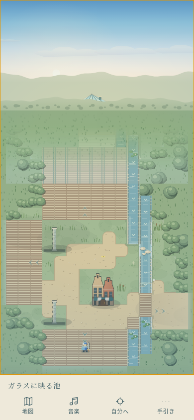
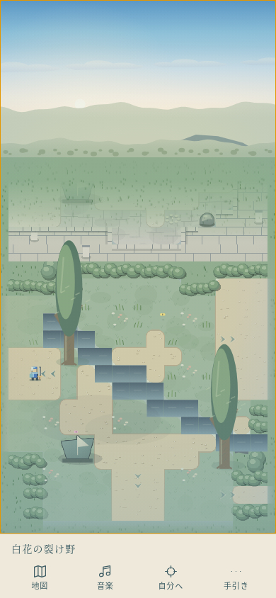
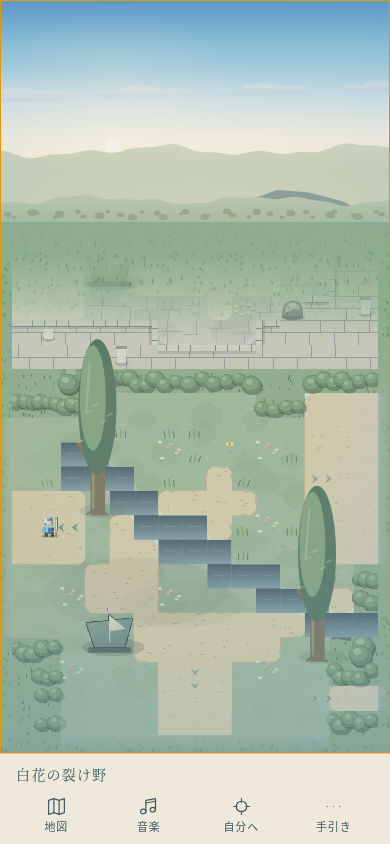
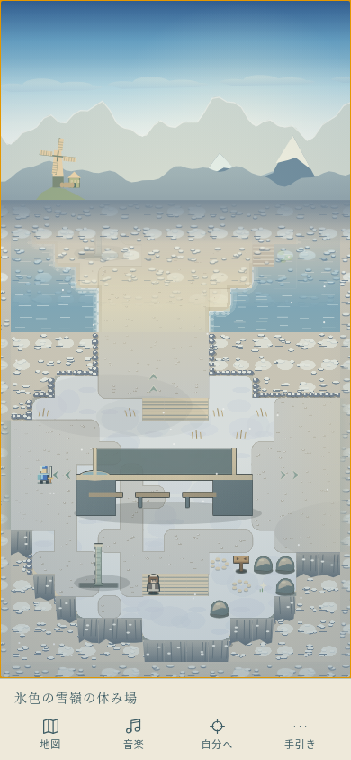
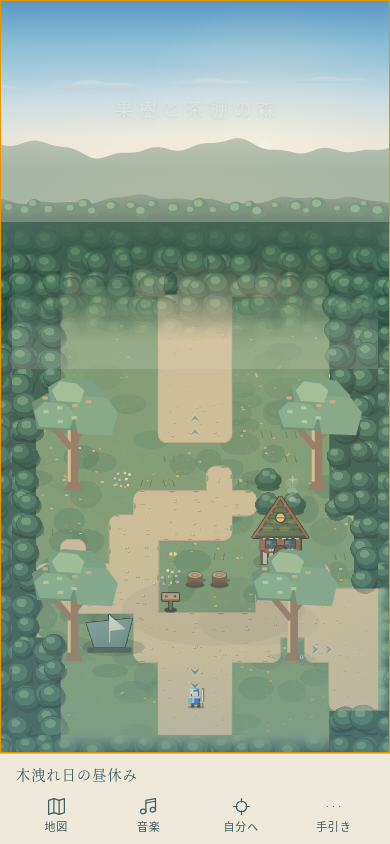
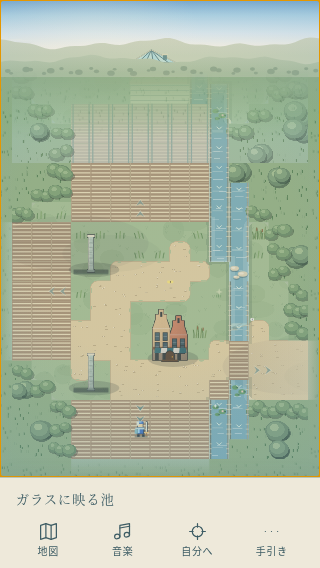
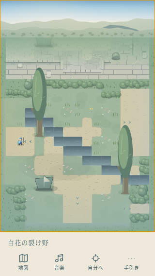
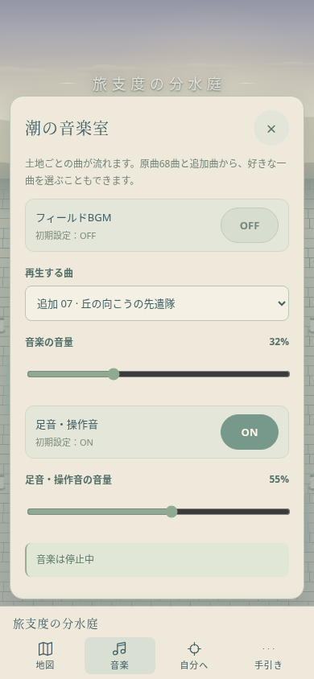

# 淡い自然の縁と地域音楽 — #144 / PR #145

変更前はmain `b527708` の独立した静的コピー、変更後はPRブランチの同じ描画。どちらも中央から通常Canvasタップで歩いて撮影した。地形・位置の書換え、ワープ、画像合成は行っていない。変更後は320×568／390×844で6地点を巡り、中央へ戻った。音楽の正確なIDは静止画から推測せず、別の実再生記録で確認した。

## 地形とオブジェの比較

|場面|変更前390px|変更後390px|
|---|---|---|
|池：茂みの塊、水路と草道の縁|||
|裂け野：道の縁と草の密度、対岸の見通し|||
|雪嶺：石の色と輪郭、足元の濃さ|||
|森の昼休み：細道と木陰の地面|||

|320pxの池|320pxの裂け野|
|---|---|
|||

## 音楽

[指定10曲と20地域の配曲表](../../FIXED-FAVOURITE-MUSIC.md)。地図上で辺を接する41組はすべて異曲、歩いて越えられる37組は主旋律の楽器か拍子も必ず変わる。地域内は代表1曲を保つ。

[実再生の記録](native-audio.json)では、起動したループの長さが譜面のID・面と一致すること、同じ地域では再スタートしないこと、境界で新しい曲に切り替わることを確認した。分水庭→返壁→分水庭→空器→池→水段→受水殿→乾殿→受水殿→温室→段畑→温室→分水庭を通常タップで歩いた。音楽室の全110曲、音量の独立設定、BGM OFFも確認。以下はその音楽室の実画面。

## 変更しない契約と未確認

全100画面のタイル、固体、入口、設備、小物、NPC、共有境界、接続、空の目印を変更前と照合し一致した（署名 `c00f50818d0398788abb8337d7d26abe2e89813043e4474094f050946f2ff0b2`）。選曲だけは今回の指示どおり変更。全110曲の元譜面・イベントのハッシュ検査、他モードの選曲・音設定・保存は維持した。

物理iPhone/Safari、実耳での曲調やクロスフェードの評価、独立監査、人間による美的受入は未確認。楽器・拍子・速度の分析と実際のAudioBuffer起動の検査を、実耳の評価として扱わない。
