# 三つの旅の実画面 — PR #140

2026-11-16。通常のCanvasタップのみで中央から往復した実画面。位置の書換え・ワープ・画像合成は使っていない。320×568 / 390×844、Chromium、BGM OFF。専用HTTPサーバーで `checkFixedLandmarks` を完走し、到着ごとの主人公の安全な床を [routes.json](routes.json) に記録した。

基本実装 `09b73f2` で全5群のCIが合格。キャプチャは同じ表示を専用サーバーで再取得した。雪嶺からの風車だけは、丘と足元を見せる最終修正 `e6c4ab9` のあと、両サイズで改めて中央から通常タップで往復して撮り直した。その修正では他の場面・経路・音は変えていない。

## 温室：三地点を同じ幅で比較

屋根の少し片寄った頂点、六分割のガラス、東の短い換気塔を追う。池では北、段畑では南の谷。段畑の谷窓と石の縁は通れない。

|画面幅|池：北にちらっと見える|庭：屋根全体と鉢に到着|段畑：南の谷へ振り返る|
|---|---|---|---|
|320px|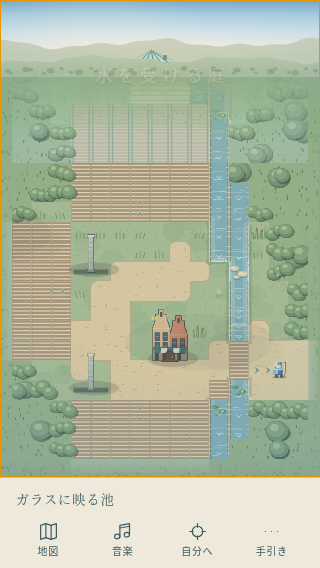|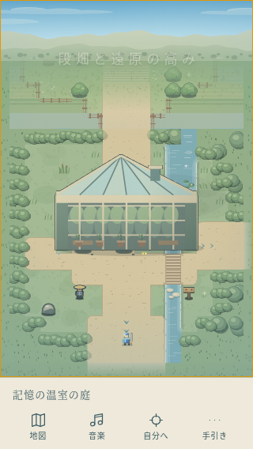|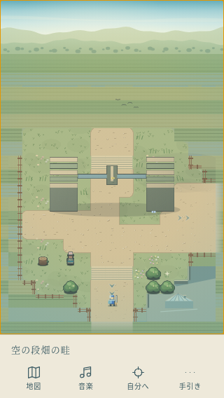|
|390px|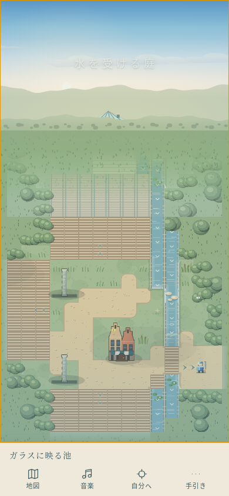|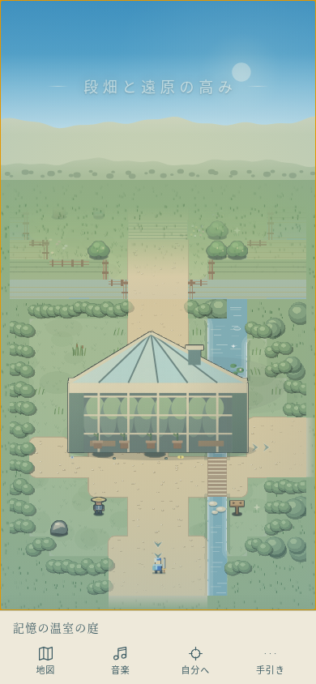|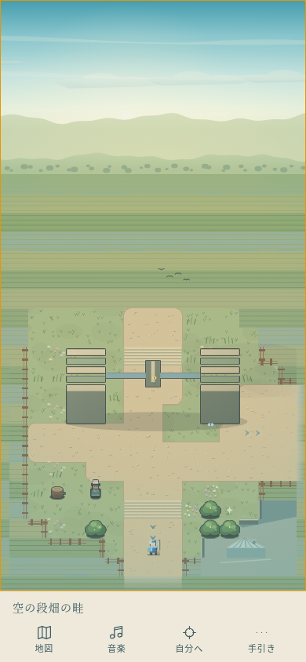|

## 風車と二峰

|風車の東に二峰と鞍部|裂け野の下側：岩肩に隠れる|上端を回った先：同じ二峰が戻る|
|---|---|---|
|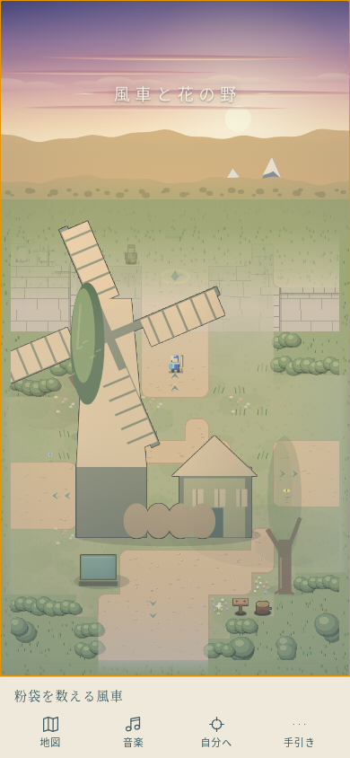|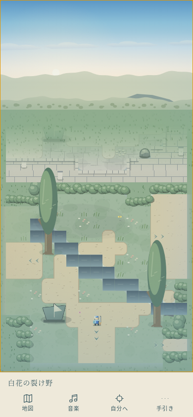|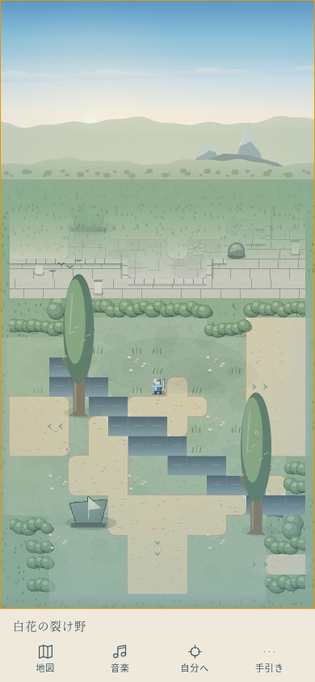|

|雪嶺から西の風車丘：320px|雪嶺から西の風車丘：390px|
|---|---|
|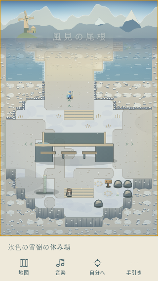|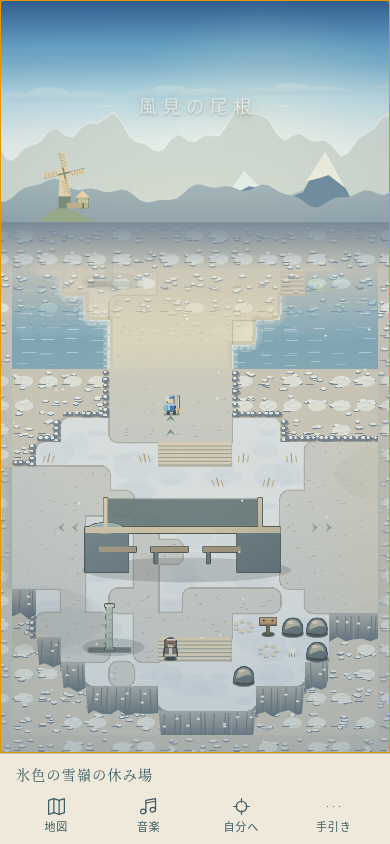|

## 水と乾いた原

|二つの橋と南へ流れる水|北の乾いた器・溝|
|---|---|
|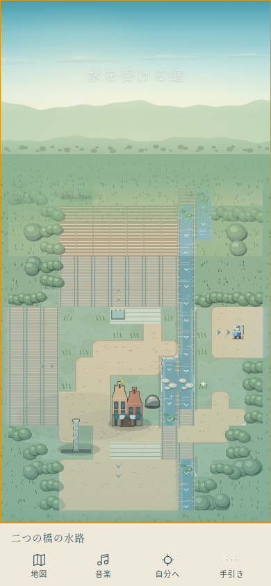|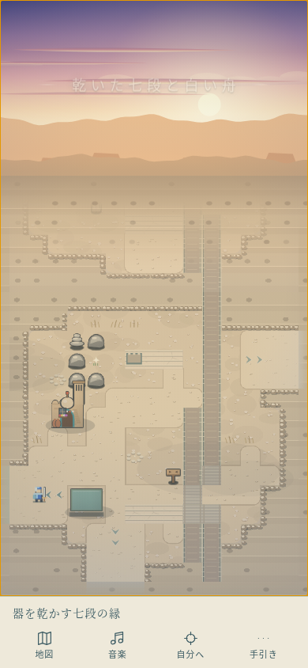|

|水の失せた七段|白い舟の原と舟板|
|---|---|
|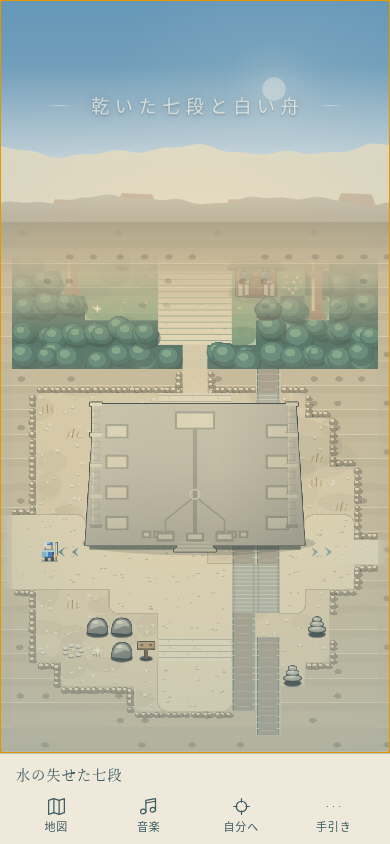|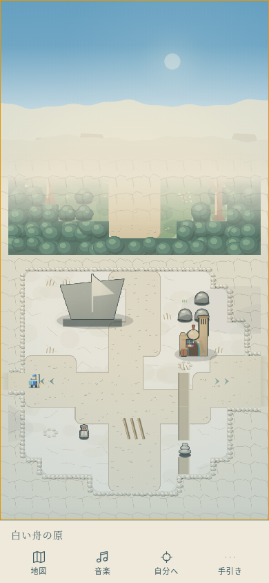|

## 試遊と未確認

中央からの矢印順は [設計・接続台帳](../../FIXED-LANDMARK-JOURNEYS.md) と [PR #140](https://github.com/hane-san/ARPG-02-retrostyle/pull/140)。各終点から同じ出口を逆にたどって戻れる。音楽はOFFでも全経路を通れる。出口矢印のない崖・水はタップしても渡れない。

[全群合格CI](https://github.com/hane-san/ARPG-02-retrostyle/actions/runs/43808563531)、[最終描画修正のCI](https://github.com/hane-san/ARPG-02-retrostyle/actions/runs/43844405881)。各CIの `atlas-browser-evidence-atlas` には全画面の証跡がある（Actionsの保持期限7日）。このフォルダの要所15枚は期限に依存せず残す。

物理iPhone／Safari、実耳、独立監査、人間による旅情・美的受入、低性能端末の長時間負荷・電池・セーフエリアは未確認。スクリーンショットとChromium検査の合格で代替しない。
