# オブジェの形状・表示不具合 — #148 / PR #149

変更前はmain `e7e0e09a070fa41e8adb1ec9315128e7082eb7a6` の独立した静的コピー。変更後は今回のアトラス描画。[原因と修正](../../FIXED-OBJECT-SHAPES.md)。診断描画と、通常タップで歩いた実画面は別の記録である。

## 全100画面の診断描画

実レンダラーを390×753で呼び出し、10画面ずつ並べた縮小WebP。オブジェ・小物・足元・輪郭・画面端を変更前後で点検した。歩行や到達性の証明には使わない。[画面ID](rooms.json)。

|画面番号|変更前|変更後|
|---|---|---|
|00–09|[一覧](before-world-sheet-00.webp)|[一覧](after-world-sheet-00.webp)|
|10–19|[一覧](before-world-sheet-01.webp)|[一覧](after-world-sheet-01.webp)|
|20–29|[一覧](before-world-sheet-02.webp)|[一覧](after-world-sheet-02.webp)|
|30–39|[一覧](before-world-sheet-03.webp)|[一覧](after-world-sheet-03.webp)|
|40–49|[一覧](before-world-sheet-04.webp)|[一覧](after-world-sheet-04.webp)|
|50–59|[一覧](before-world-sheet-05.webp)|[一覧](after-world-sheet-05.webp)|
|60–69|[一覧](before-world-sheet-06.webp)|[一覧](after-world-sheet-06.webp)|
|70–79|[一覧](before-world-sheet-07.webp)|[一覧](after-world-sheet-07.webp)|
|80–89|[一覧](before-world-sheet-08.webp)|[一覧](after-world-sheet-08.webp)|
|90–99|[一覧](before-world-sheet-09.webp)|[一覧](after-world-sheet-09.webp)|

## 86通りの個別描画

文化・役割・寸法・倍率・小物・仕上げ設定で重複を除いた86通り。余白は原図の全ピクセルと比較し、無効な寸法・色・Canvas状態の漏れも測った。[変更前の数値](before-objects.json)、[変更後の数値](after-objects.json)。風車2種と夜の梁の測定余白不足を再現し、修正後は全86例で超過0・不正状態0。

以下は個別の原図に仕上げを重ねた診断一覧。庭の床と柱の分離は実際の画面合成で行うため、個別の庭の画像だけでは人物の可視性を示さない。

|設定番号|変更前|変更後|
|---|---|---|
|00–11|[一覧](before-objects-sheet-00.webp)|[一覧](after-objects-sheet-00.webp)|
|12–23|[一覧](before-objects-sheet-01.webp)|[一覧](after-objects-sheet-01.webp)|
|24–35|[一覧](before-objects-sheet-02.webp)|[一覧](after-objects-sheet-02.webp)|
|36–47|[一覧](before-objects-sheet-03.webp)|[一覧](after-objects-sheet-03.webp)|
|48–59|[一覧](before-objects-sheet-04.webp)|[一覧](after-objects-sheet-04.webp)|
|60–71|[一覧](before-objects-sheet-05.webp)|[一覧](after-objects-sheet-05.webp)|
|72–83|[一覧](before-objects-sheet-06.webp)|[一覧](after-objects-sheet-06.webp)|
|84–85|[一覧](before-objects-sheet-07.webp)|[一覧](after-objects-sheet-07.webp)|

## 通常タップの実画面

中央の分水庭から実際のCanvasタップで歩いた原寸PNG。位置の書換え・ワープ・画像合成は行っていない。両庭は歩ける(7,4)まで実際に移動し、変更前に床へ消えていた主人公が修正後には見える。

|390pxの地点／症状|変更前|変更後|
|---|---|---|
|水を受ける七段：床が主人公を塗りつぶす|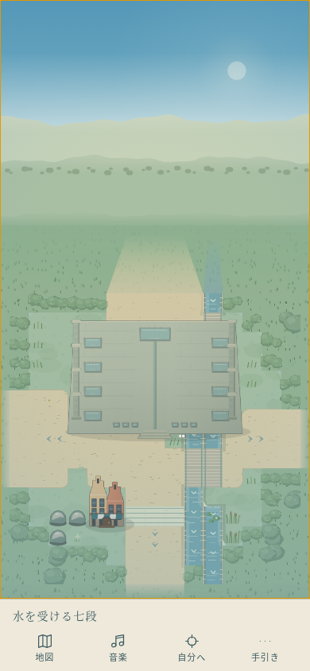|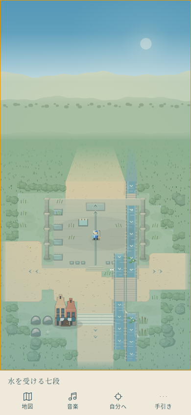|
|水の失せた七段：同じ床の重なり|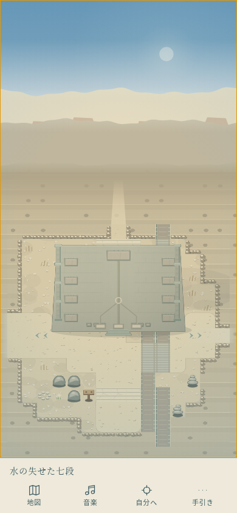|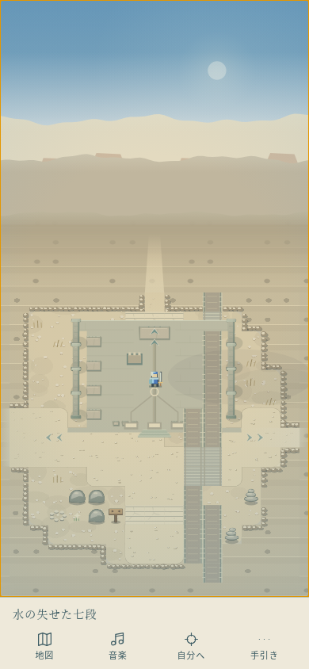|
|葦の板道：屋根と柱脚の間|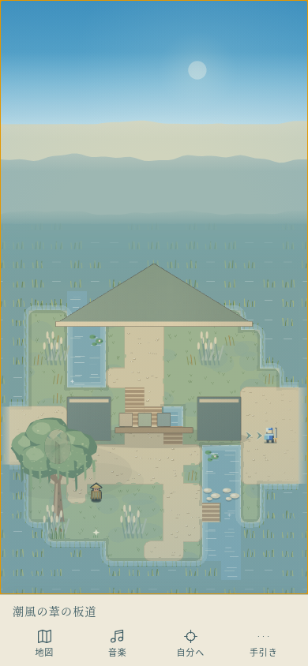|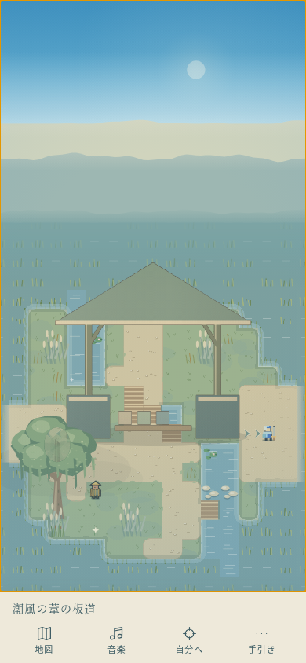|
|段畑：上段の浮き|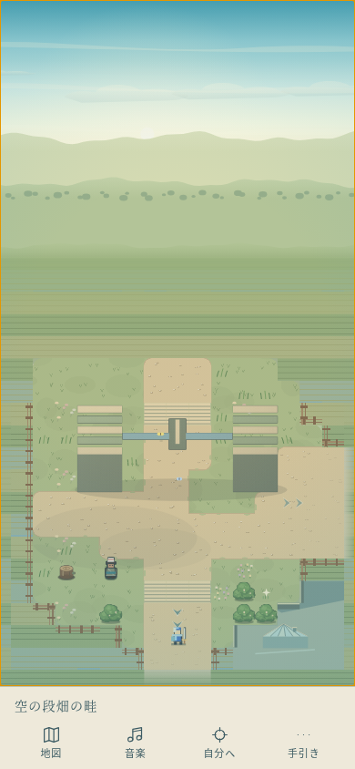|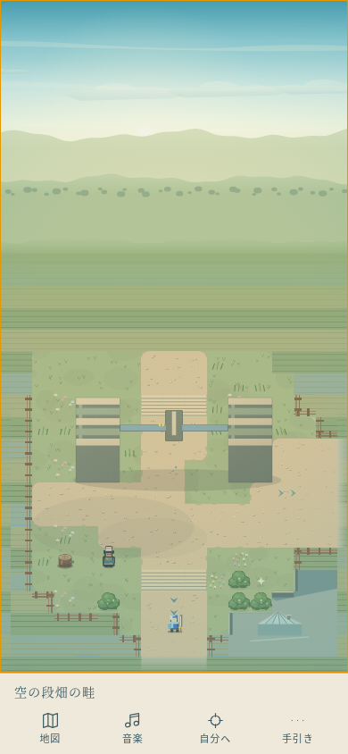|
|柳の腰掛け：背板と脚の間|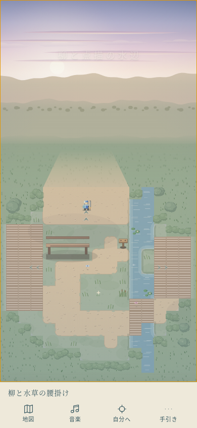|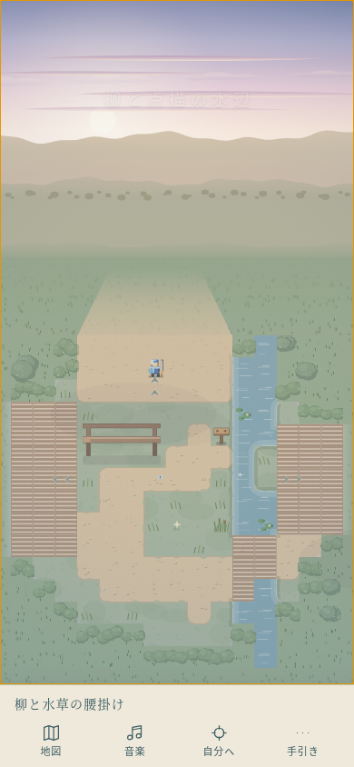|
|川の輪：水樋・軸と輪の間|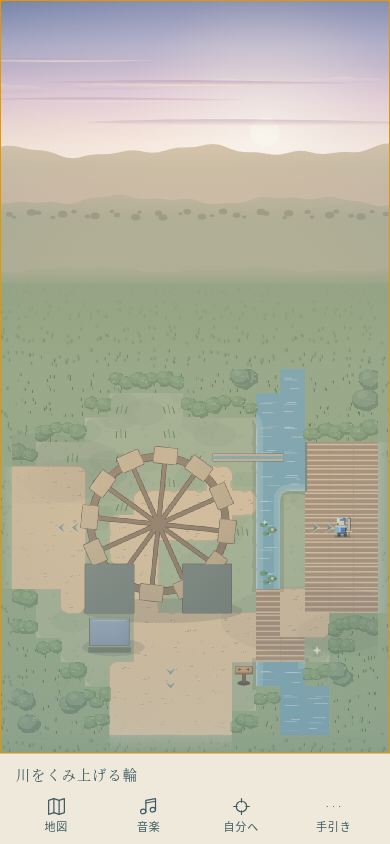||
|白い舟：影の濃い台座|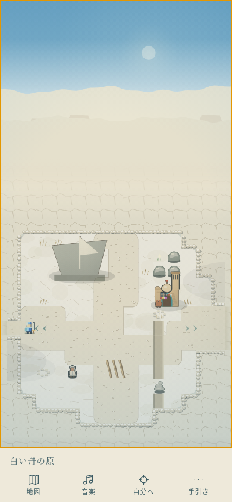|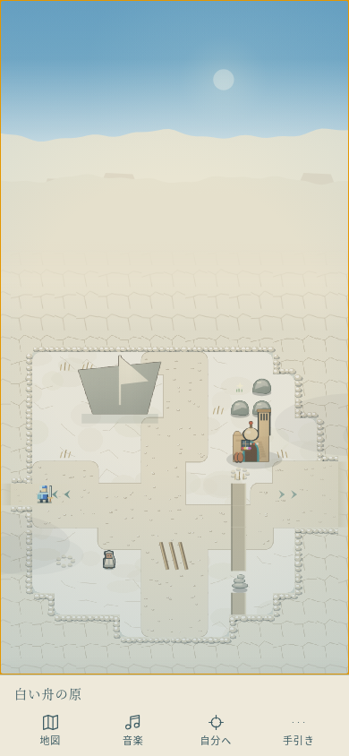|

|320px：庭の主人公|390px：風車|390px：高い分水梁|
|---|---|---|
|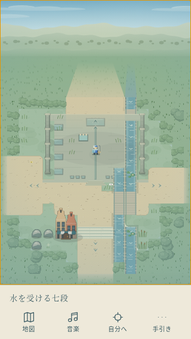|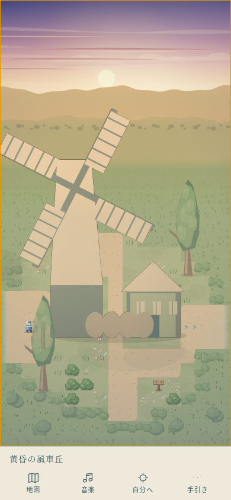|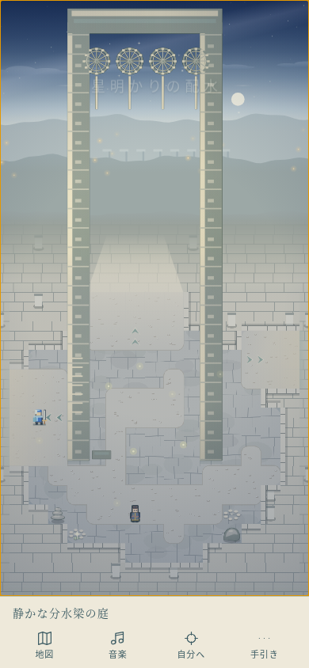|

320×568／390×844の両方で、分水庭→川の輪→水を受ける七段→水の失せた七段→白い舟→葦の板道→段畑→風車→柳の腰掛け→夜の分水梁と歩き、逆順に戻った。安全な着地・地域の曲・独立した音設定の維持・実行時エラー0を確認。変更前390pxも同じ往復を実行した。[変更前18訪問](before-routes.json)、[変更後36訪問](after-routes.json)。

## 描画回帰と不変データ

[追加検査](renderer-check.json)は、薄い影のアルファ維持（38→38／実物の器37→37）、動く形の20時刻の余白、高い梁の輪郭、844px横画面の羽根の張出し、部品の接続、水車4時刻、庭での人物の可視性8例を確認する。[変更前の庭の隠蔽](before-court-occlusion.json)では人物あり／なしの画面差が0pxの地点を再現した。

全100画面のデータ（床・固体・入口・共有境界・接続・木・設備・小物・NPC・空の目印・選曲）は変更前と完全一致。JSON SHA-256：`4bd826ea4ee83f5da2134732dc472a5bf1e71697afd53adfdd57e1ba62456b54`。110曲の原譜・ID、20地域の指定10曲、保存・音設定を変更していない。既存の全床・出口往復・安全着地・連続世界と旧モードの検査も維持。

物理iPhone/Safari、実耳、独立監査、人間の美的受入、低性能端末の長時間負荷は未確認。特に実機では庭の人物、風車の回転、支えと足元、画面切替中の形、320px相当の出口を確認する。
