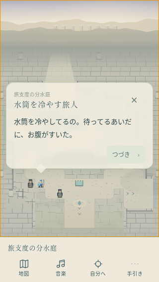
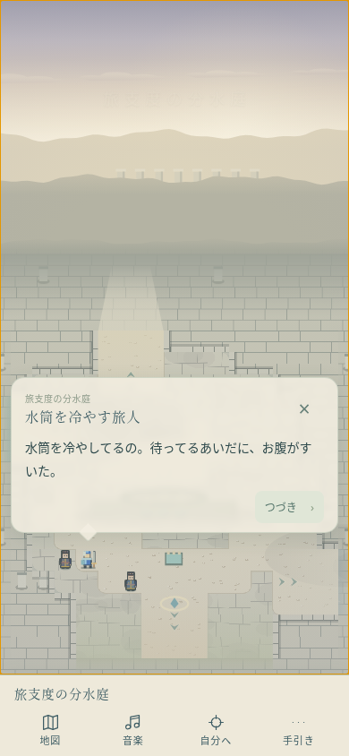
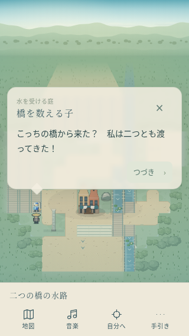
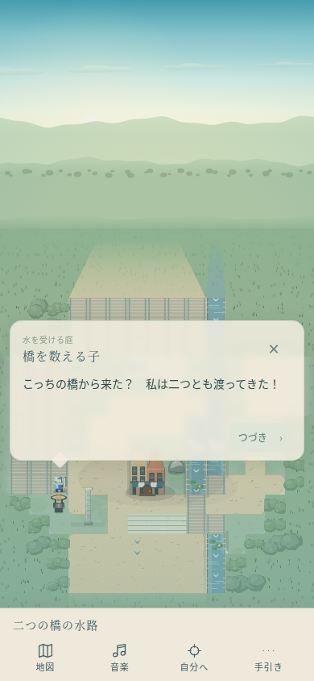
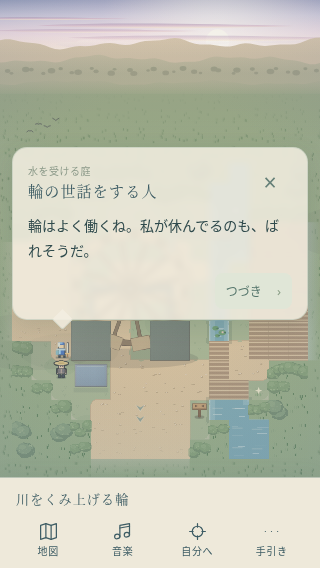
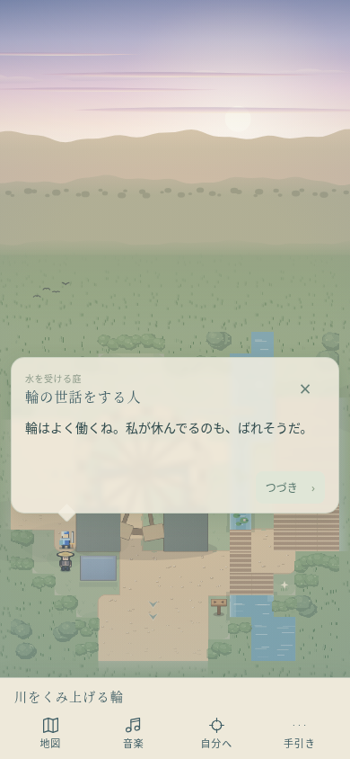
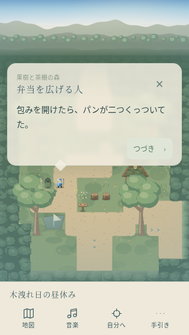
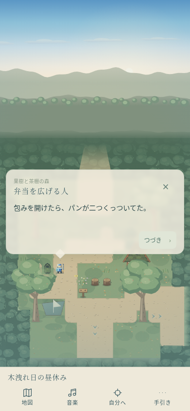
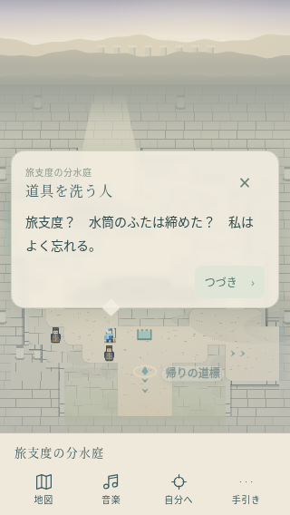
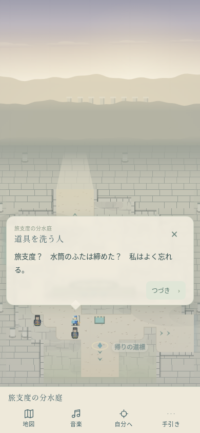

# 人々と短い会話 — #150 / PR #151

中央から通常タップで、分水庭→二橋→川の輪→森の昼休みへ歩き、逆順に戻る。分水庭では追加人物と既存人物の両方へ会う。320×568／390×844で計14回、2文とも表示し、閉じて歩行に戻る操作を確認。カードが画面内に収まり、実行時エラー0。ワープ・位置書換え・画像合成は使っていない。[会話とカード寸法の記録](conversations.json)。

|人|320px|390px|
|---|---|---|
|追加：水筒を冷やす旅人|||
|追加：橋を数える子|||
|追加：輪の世話をする人|||
|追加：弁当を広げる人|||
|既存：道具を洗う人|||

全44人の床と隣接会話位置への到達性、会話の短さ・重複なし、配置の再現性と静かな区間はNodeで検証。地形・木・設備・小物・共有境界は変更前と一致。全会話は[台帳](../../FIXED-PEOPLE.md)。実機iPhone/Safari、実耳、独立監査、人間の文章受入は未確認。
