# 輪郭と素材の小さな調整 — #142 / PR #143

変更前はmain `59445ef` の独立した静的コピー、変更後はPRブランチ。いずれも中央から通常Canvasタップだけで6画面へ歩き、最後は中央へ戻って撮影・確認した。位置の書換え、ワープ、画像合成は使っていない。建築の形・足元・入口は同じで、素材の線、石の目地、屋根と窓枠の色を小さく変えた。

|場所と調整|変更前（390px）|変更後（390px）|
|---|---|---|
|分水庭：輪と台座の石の層、薄い素材色の縁|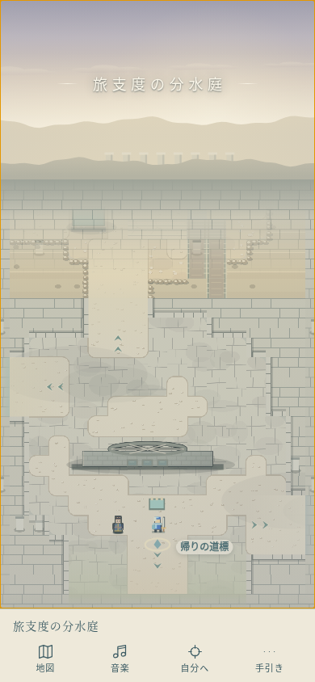|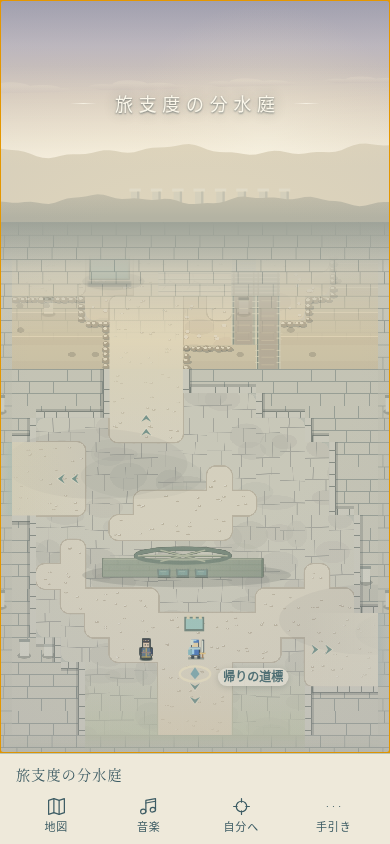|
|水を受ける七段：石床の淡い目地、受け皿と柱の縁|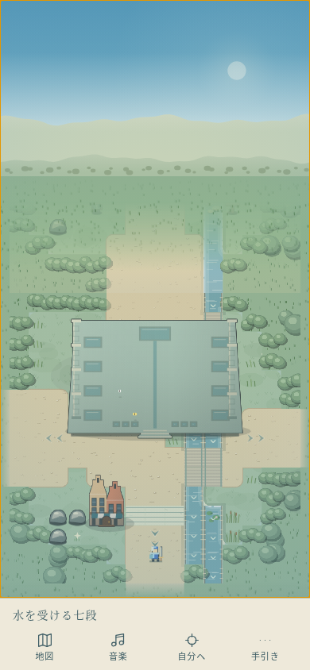|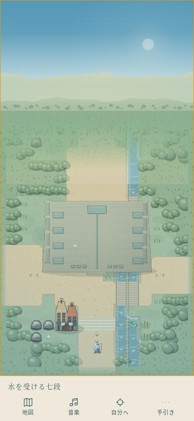|
|水の失せた七段：同じ造りの乾いた縁と水位跡|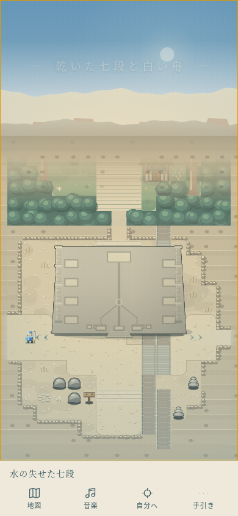|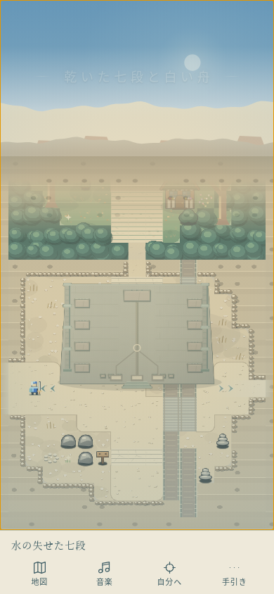|
|青い灯の休み処：灰緑の屋根と木枠、青灯を残す|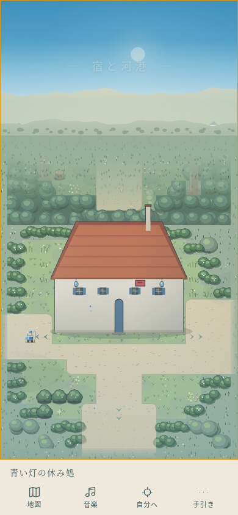|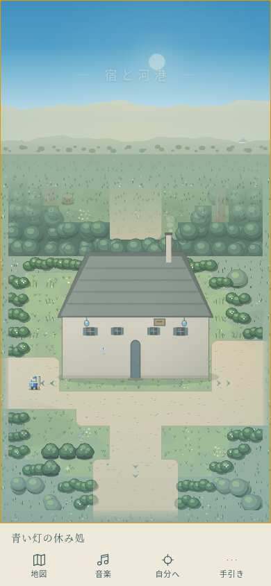|
|木陰の河港：少しくすんだ壁・庇と柔らかい枠|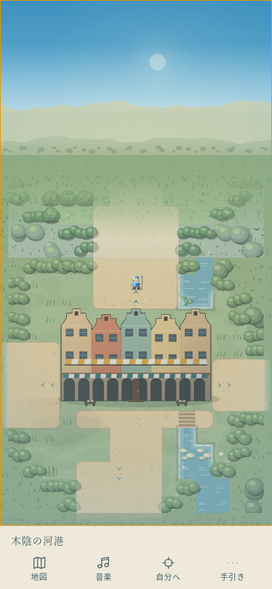|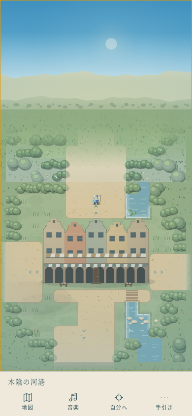|
|果樹の窓辺：土色の屋根と落ち着いた窓枠|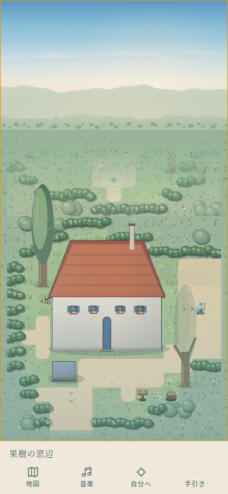|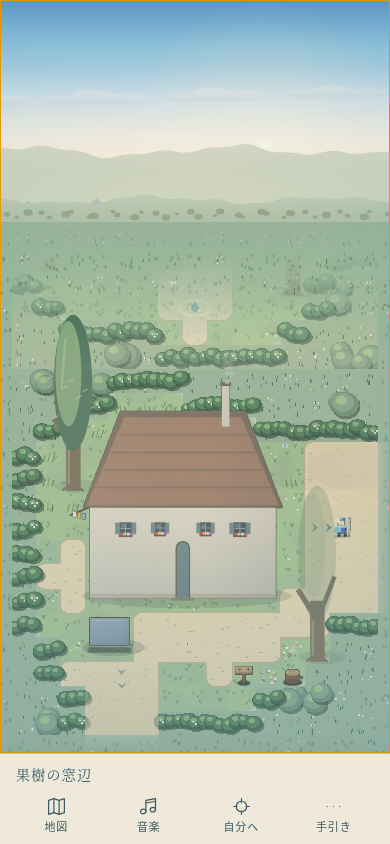|

## 小さい縦画面

変更後の6画面は320×568と390×844の両方で歩いて確認。次の2枚は320pxの実画面。出口・人物・入口の濃さは残した。

|水を受ける七段|青い灯の休み処|
|---|---|
|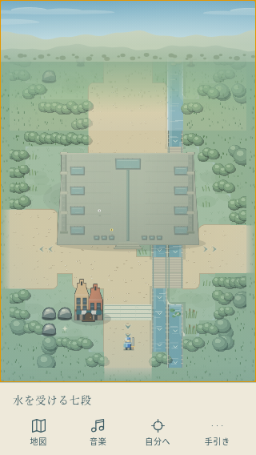|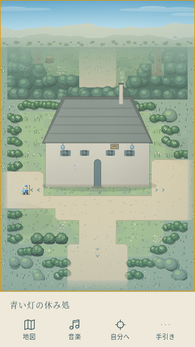|

## 確認した境界

対象6画面の主オブジェクトだけに素材別のfinishを適用。全100画面のタイル、固体、入口、主設備・小物、NPC、共有境界、接続、曲・エリア・プレイリストを変更前と照合し、一致した（SHA-256: `5eed252bf51caaec9fa100183525f9ead8c5cf49258f728dfe2924b7337a983e`）。水・乾いた溝・温室と風車の共通目印も変更していない。造形の調整は画面切替版の描画内だけで行い、つながった世界と旧モードの素材は元のまま。

物理iPhone/Safari、実耳、独立監査、人間による美的受入は未確認。実画面の見比べとChromiumの試遊で代替したとは扱わない。
