# 木々・小物と上部景観 — #146 / PR #147

変更前はmain `1aea0e9` の独立した静的コピー。変更後は今回のアトラス描画。診断用の100画面描画と、実際の通常タップで歩いた画面を区別する。

## 全100画面の描画点検

以下は実レンダラーを390×753で呼び出し、10画面ずつ並べた診断一覧（縮小WebP）。歩行や到達性を証明する画像としては扱わない。全画面の木々・境界・上部景観・高い設備・目印を変更前後で点検した。[100画面のIDと属性](rooms.json)。

|画面番号|変更前|変更後|
|---|---|---|
|00–09|[一覧](before-sheet-00.webp)|[一覧](after-sheet-00.webp)|
|10–19|[一覧](before-sheet-01.webp)|[一覧](after-sheet-01.webp)|
|20–29|[一覧](before-sheet-02.webp)|[一覧](after-sheet-02.webp)|
|30–39|[一覧](before-sheet-03.webp)|[一覧](after-sheet-03.webp)|
|40–49|[一覧](before-sheet-04.webp)|[一覧](after-sheet-04.webp)|
|50–59|[一覧](before-sheet-05.webp)|[一覧](after-sheet-05.webp)|
|60–69|[一覧](before-sheet-06.webp)|[一覧](after-sheet-06.webp)|
|70–79|[一覧](before-sheet-07.webp)|[一覧](after-sheet-07.webp)|
|80–89|[一覧](before-sheet-08.webp)|[一覧](after-sheet-08.webp)|
|90–99|[一覧](before-sheet-09.webp)|[一覧](after-sheet-09.webp)|

点検で、細長い楕円の木、同じ三角形の針葉樹、同心円のような森の縁、歩ける細道を狭く見せる葉の張り出し、上部の北隣の石段や崖の大きな切抜きを確認した。修正内容は[設計と結果](../../FIXED-WOODLAND-FRAMING.md)。北へ続くのは実際の道・橋・石段だけとし、広い草地の出口全体が扇状の道になる見え方も防いだ。

## 通常タップの実画面（変更前後）

以下は中央の分水庭から実際のCanvasタップで歩いた画面。位置の書換え、ワープ、画像合成は行っていない。描画用の診断一覧とは別の記録である。

|地点|変更前390px|変更後390px|
|---|---|---|
|木立：細長い木と枝葉|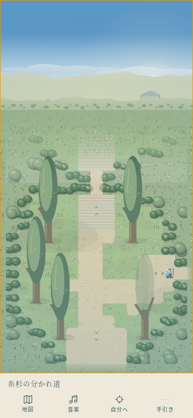|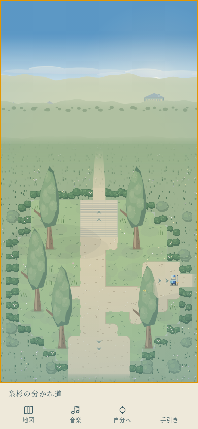|
|森：葉の重なりと細道|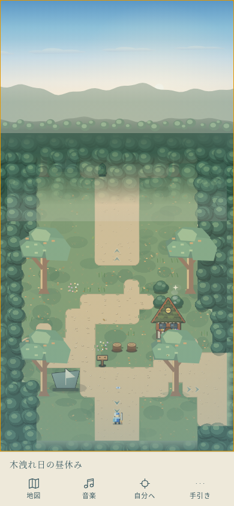|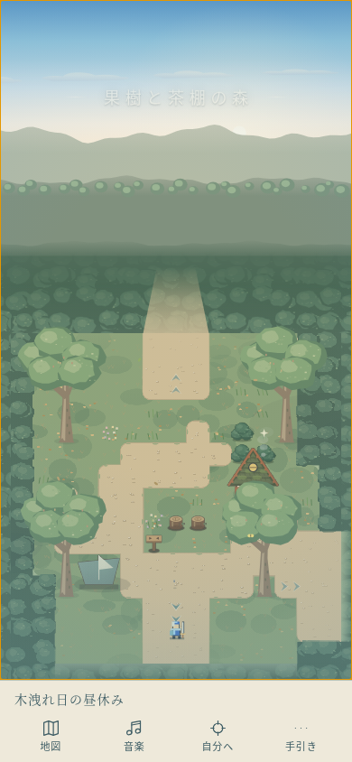|
|柳の水辺：幹と垂れる葉|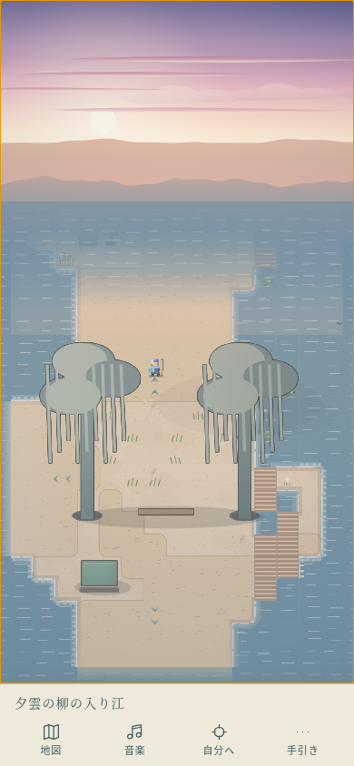|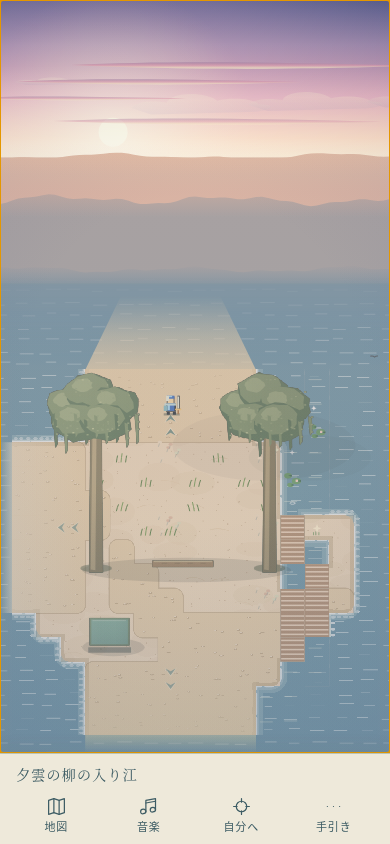|
|裂け野：上部の別盤面の断片|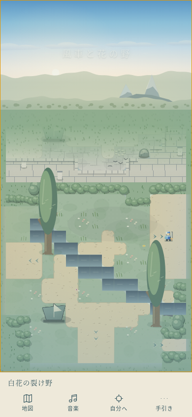|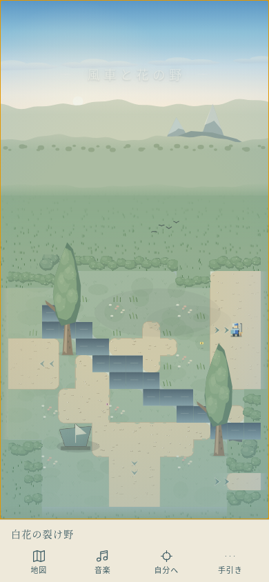|

|320px：受水殿|320px：針葉樹|390px：高い分水梁|
|---|---|---|
|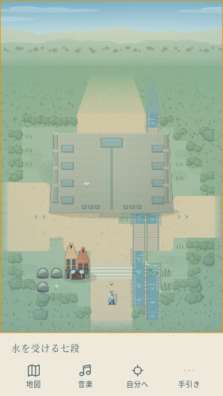|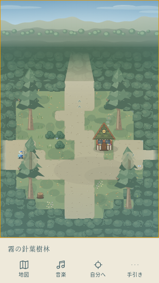|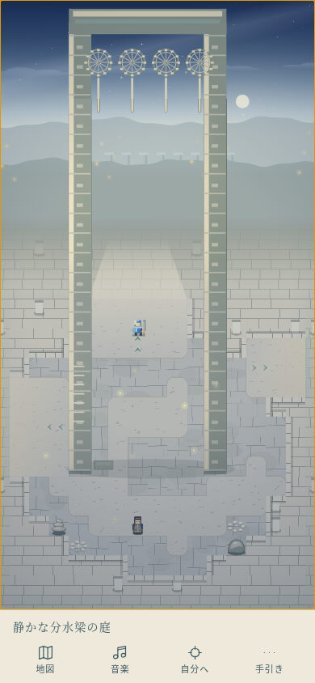|

## 操作と回帰の記録

320×568／390×844で `分水庭→池→受水殿→木立→針葉樹→柳の水辺→雪嶺→裂け野→夜の分水梁→森の昼休み` の9地点へ通常タップで歩き、訪問順の逆に全地点を通って分水庭へ帰った。両幅とも全行程を完走し、安全な着地・曲選択・独立した音設定の維持・実行時エラー0を確認。変更前390pxも同じ行程を完走した。[変更前の往復記録](before-routes.json)、[変更後の両幅の往復記録](after-routes.json)。

[描画回帰の結果](renderer-check.json)：320/390縦では別盤面の実物大の断片が描かれず、844横では隣接風景が残る。草地の出口の広さで上部の道が広がりすぎず、人の周り以外の葉のアルファはCanvas量子化の微差を除いて一致し、人の周りだけ薄くなる。同じ樹冠を再描画して形が一致する。

全100画面のデータ（床・固体・入口・共有境界・接続・木・設備・小物・NPC・空の目印・選曲）は変更前と一致。JSON SHA-256：`4bd826ea4ee83f5da2134732dc472a5bf1e71697afd53adfdd57e1ba62456b54`。

物理iPhone/Safari、実耳、独立監査、人間の美的受入、低性能端末の長時間負荷は未確認。
